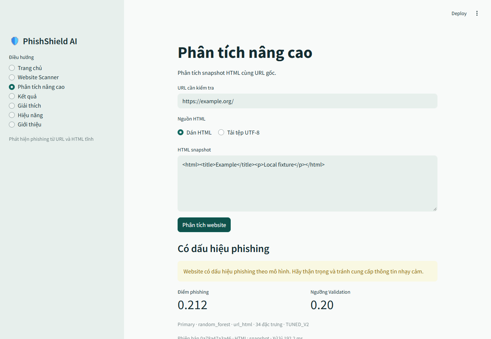

# PhishShield AI

Ứng dụng tiếng Việt sàng lọc website bằng Random Forest đã huấn luyện trên CompPhish v4. Nhập URL trong Full Scan để ứng dụng tự tải HTML tĩnh và chạy mô hình chính. Quick Scan phân tích URL ngoại tuyến, còn Snapshot Analysis dùng HTML bạn cung cấp. Streamlit gọi FastAPI qua HTTP. Mỗi kết quả có điểm, ngưỡng thực, phiên bản checkpoint và các yếu tố đóng góp.



## Chạy trên Windows

Cần Git, PowerShell, uv, hai cổng local trống và bộ model **phishshield-models-v1.0.0.zip** do trưởng nhóm cung cấp riêng. Lần cài dependency đầu tiên cần Internet hoặc cache uv phù hợp. Sau khi cài xong có thể ngắt mạng và Drive. Runtime chỉ cần CPU.

```powershell
git clone https://github.com/vohuunghiaah/phishshield-ai.git
cd phishshield-ai
.\setup.ps1 -ModelSource 'C:\path\to\phishshield-models-v1.0.0.zip'
.\start.ps1 -FullScan
```

Full Scan cần Docker Desktop chạy Linux containers và kết nối Internet. Dùng `.\start.ps1 -Offline` cho Quick Scan và Snapshot Analysis. Sau khi dừng ứng dụng, chạy `docker compose -f compose.fetcher.yaml down` để dừng worker.

Mở [giao diện](http://127.0.0.1:8501) hoặc [Swagger](http://127.0.0.1:8000/docs). Dừng bằng Ctrl+C trong cửa sổ chạy hoặc `.\stop.ps1` từ cửa sổ khác. Bộ cài đối chiếu checksum và so dự đoán của cả hai model với fixture đã lưu. Google Drive chỉ cần khi thành viên chọn cài model trực tiếp từ thư mục nghiên cứu được cấp quyền. [Cài model](docs/product/MODEL_INSTALLATION_GUIDE.md) · [Windows](docs/product/LOCAL_DEPLOYMENT_GUIDE.md).

## Chọn chế độ

| Chế độ | Đầu vào | Checkpoint |
|---|---|---|
| Quick Scan | URL HTTP(S), không truy cập trang | RF 17 biến, seed 44, ngưỡng 0,15 |
| Snapshot Analysis | URL và snapshot HTML tĩnh, tối đa 8 MiB | RF 34 biến, seed 43, ngưỡng 0,20 |
| Full Scan | URL HTTP(S) công khai, HTML tĩnh tối đa 2 MiB | RF 34 biến, seed 43, ngưỡng 0,20. Nếu website không cung cấp được HTML, dùng RF 17 biến và hiển thị lý do |

HTML được xử lý trong parser tĩnh. Điểm chưa được calibration. Giải thích runtime dùng hiệu điểm khi thay từng biến từ trung vị Train. [An toàn và giới hạn](docs/product/SECURITY_MODEL.md) · [Hướng dẫn sử dụng](docs/product/USER_GUIDE.md).

## API và Docker

```python
import requests
r = requests.post("http://127.0.0.1:8000/predict",
                  json={"url":"https://example.org/","mode":"full"},timeout=25)
r.raise_for_status()
print(r.json())
```

Sau khi cài model, có thể chạy `docker compose -f compose.yaml -f compose.fullscan.yaml up --build -d --wait` thay cho launcher Windows. Cả hai service bind ở loopback của máy chủ. Checkpoint mount read-only cho API. [Docker](docs/product/DOCKER_DEPLOYMENT_GUIDE.md) · [Contract](docs/product/API_REFERENCE.md).

## Bằng chứng nghiên cứu

Cohort 15.327 mẫu, chia Train/Validation/Test theo nhóm domain và snapshot trùng. So sánh RF, XGBoost và MLP theo hai modality, ba seed. Có 18 baseline, 144 trial (432 outer-fold evaluations) và 18 tuned run. XGBoost baseline URL+HTML đạt F2 Validation trung bình 96,048%. RF tuned URL+HTML đứng đầu tập ứng viên V2 theo giao thức với 95,920%. Trưởng nhóm duyệt lựa chọn trước Test.

| Chỉ số primary trên 2.299 mẫu Test | F2 | Recall | Accuracy | Precision | ROC-AUC | FPR |
|---|---:|---:|---:|---:|---:|---:|
| % | 96,102 | 98,422 | 92,866 | 87,821 | 98,979 | 12,029 |

Có 147 FP và 17 FN. Fallback chưa chấm Test riêng. Dữ liệu và điều kiện vận hành mới có thể thay đổi hiệu năng. Richa Goenka phát hành CompPhish v4 theo CC BY 4.0. Quyền phân phối checkpoint và giấy phép mã nguồn được xem xét riêng. [Nguồn dữ liệu](https://data.mendeley.com/datasets/fmbs4kp9wz/4) · [Model card](MODEL_CARD.md) · [Báo cáo đồ án](reports/final/PhishShield-AI-Final-Report.pdf) · [Giao thức khoa học](docs/final/PHISHSHIELD_AI_EXPERIMENT_PROTOCOL_AND_ANALYSIS.md).

## Kiến trúc và kiểm thử

Streamlit → FastAPI → trích đặc trưng URL/HTML → chọn RF → score, threshold và đóng góp → JSON. Triển khai dùng Python 3.11.15, scikit-learn 1.6.1, FastAPI, Uvicorn, lxml và Streamlit. `src/phishshield/` chứa các module. `notebooks/`, `configs/` và `scripts/` chứa workflow nghiên cứu. `docs/product/` dành cho triển khai; `reports/product/` lưu bằng chứng nghiệm thu. Bản công khai của bảng phân tích lỗi chỉ chứa số tổng hợp.

```powershell
uv sync --frozen --python 3.11.15 --extra demo --extra test --extra trees --extra tuning
uv run --no-sync pytest -q
uv run --no-sync python scripts/verify_local.py
```

Lệnh cuối cần API đang chạy. CI sử dụng fixture tổng hợp. Chấp nhận hai checkpoint chính thức được kiểm tra local với bundle riêng. [Yêu cầu sản phẩm](docs/product/PRODUCT_REQUIREMENTS.md) · [Kiến trúc](docs/product/SYSTEM_ARCHITECTURE.md) · [Kịch bản demo](docs/product/DEMO_GUIDE.md) · [Xử lý sự cố](docs/product/TROUBLESHOOTING.md) · [Nghiệm thu Full Scan](reports/product/FULL_SCAN_ACCEPTANCE.md) · [Kết quả Gate 7](reports/product/GATE7_ACCEPTANCE_REPORT.md).

## Nhóm thực hiện

Gịp Xương Thanh Quyền phụ trách Random Forest. Vũ Thị Tuyết Trang phụ trách XGBoost. Võ Hữu Nghĩa phụ trách MLP và trưởng nhóm.
