# PhishShield AI • Giao thức thực nghiệm và phân tích kết quả

*Bản công khai Gate 7. Các bảng theo mẫu được tổng hợp để bảo vệ dữ liệu nghiên cứu.*

**Phát hiện website lừa đảo và giải thích dấu hiệu nguy hiểm bằng Machine Learning**  
*PhishShield AI: Machine Learning-Based Phishing Website Detection with Explainable Predictions*

**PSAI–FINAL 1.0 · 28/11/2026 · Hồ sơ hậu nghiệm**

Trên 2.299 mẫu Test, Random Forest URL+HTML phát hiện 1.060/1.077 mẫu phishing và cảnh báo nhầm 147/1.222 mẫu hợp lệ. Báo cáo giải thích cách nhóm chọn điểm vận hành này trước khi mở Test, đối chiếu với hai họ mô hình còn lại trên Validation và xác định phần bằng chứng có thể chuyển sang ứng dụng. Tệp số liệu đi kèm giữ độ chính xác gốc; trong văn bản, “đpt” là điểm phần trăm.

## 1. Thông tin và quản lý giao thức

| Thành viên | Trách nhiệm thực nghiệm |
|---|---|
| Gịp Xương Thanh Quyền | Random Forest, hai modality, notebook 07a và 07 |
| Vũ Thị Tuyết Trang | XGBoost, hai modality, notebook 08a và 08 |
| Võ Hữu Nghĩa | MLP, notebook 09a và 09; Project Leader, nghiệm thu lựa chọn trước Test |

Chủ nhiệm xác nhận phân công trong lần bàn giao. Tên người duyệt lưu trong manifest là Vohuunghia. Bản V1 quy định baseline cố định và giữ ở docs/EXPERIMENT_PROTOCOL_V1.md. V2 bổ sung CV trên Train, ngân sách tìm kiếm và quy tắc khóa trước Test. Final Analysis được viết sau Test. Các RQ/H dưới đây hệ thống hóa việc đã làm; bằng chứng đăng ký trước chỉ áp dụng cho quyết định có trong tài liệu và manifest đương thời.

Nhóm đối chiếu 21 mục của ProtoEnergy-IDS_GiaoThuc_V01.docx, bản V02_EXT và báo cáo Stage6 V01 để xây dựng chuỗi câu hỏi → phép đo → kiểm tra → diễn giải. Workspace tham chiếu có V02_EXT; đường dẫn docs/V03/EXPERIMENT_PROTOCOL.md chưa thấy trong cây tài liệu đã rà. Đơn vị đánh giá của PhishShield là website snapshot gán nhãn nhị phân.

Trạng thái bàn giao: đã kiểm toán hồ sơ khóa và kiểm thử ứng dụng trên loopback. Ma trận nghiệm thu ghi phạm vi bằng chứng ở reports/final/FINAL_ACCEPTANCE_REPORT.md.

## 2. Đặt vấn đề

Phishing dẫn người dùng tới trang giả mạo nhằm lấy thông tin hoặc thuyết phục họ thực hiện hành động bất lợi. Danh sách chặn hữu ích khi địa chỉ đã được báo cáo; trong khoảng thời gian trước khi có mục tương ứng, cần tín hiệu khác. Đồ án ước lượng điểm phishing từ hình thức URL và cấu trúc HTML tĩnh. Người vận hành có thể nhận cảnh báo kèm yếu tố đóng góp để kiểm tra; quyết định nhạy cảm vẫn cần xác minh độc lập.

Một quan sát gồm địa chỉ và snapshot cùng ID. Nhãn y = 0 chỉ legitimate, y = 1 chỉ phishing. Khi HTML vắng mặt, mô hình dự phòng nhận bộ đặc trưng URL. Thí nghiệm chỉ đo hai lớp có nhãn trong CompPhish, chưa đo khả năng phát hiện mọi chiến dịch hoặc loại tấn công mới. Hình F01 cho thấy ranh giới giữa phát triển mô hình và chấm holdout.

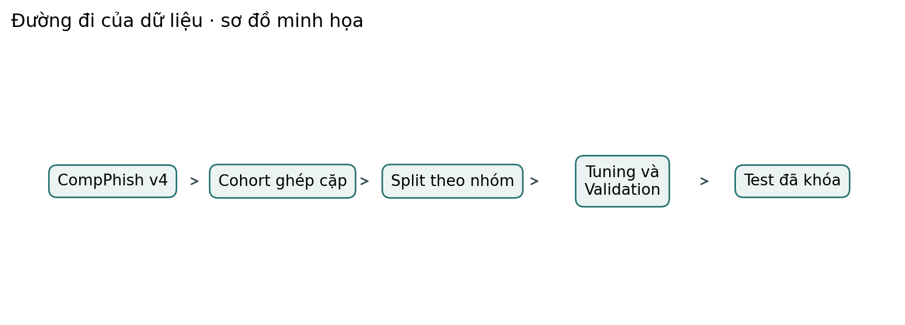

## 3. Câu hỏi nghiên cứu và giả thuyết

| Câu hỏi hậu nghiệm | Giả thuyết hoặc tiêu chí | Bằng chứng |
|---|---|---|
| RQ1. RF, XGBoost và MLP xếp hạng ra sao? | H3. Cây có thể phù hợp với đặc trưng đếm, tỷ lệ và tương tác | Cùng split, F2 Validation của 36 run, T11–T16 |
| RQ2. HTML bổ sung bao nhiêu thông tin? | H1. Thêm snapshot có lợi khi cấu hình trong cùng họ cố định | Ablation baseline ghép seed, T18 |
| RQ3. Tuning có cải thiện so với cấu hình gốc? | H2. Cải thiện OOF có thể không chuyển sang Validation | T13, T17, T19 |
| RQ4. Đặc trưng nào ảnh hưởng tới điểm? | H4. Attribution có thể hỗ trợ diễn giải một cảnh báo | SHAP trên 24 Validation; chưa có nghiên cứu người dùng |
| RQ5. Có thể triển khai hai đường suy luận? | API phải tái hiện checkpoint và ngưỡng đã chọn | Phản hồi HTTP, kiểm thử trình duyệt và đối chiếu offline |

## 4. Dataset và đơn vị quan sát

Richa Goenka công bố CompPhish v4 ngày 24/08/2026 trên Mendeley Data, CC BY 4.0. Tác giả thu thập từ 09/2024 đến 08/2025. Trang phishing đến từ PhishTank và OpenPhish; tập legitimate dựa vào danh sách DataForSEO Top-1000. Khác biệt nguồn tuyển mẫu có thể làm mô hình học độ phổ biến hoặc độ phức tạp của trang. Giai đoạn thu thập tổng thể không thay cho timestamp đáng tin cậy của từng quan sát. [Bản dữ liệu, DOI 10.17632/fmbs4kp9wz.4](https://data.mendeley.com/datasets/fmbs4kp9wz/4)

Mapping_File.xlsx cung cấp ID, URL và nhãn; All_HTML.zip ghép từng ID với snapshot. All_Features_threshold90.xlsx và Data_Dictionary.xlsx dùng đối chiếu bảng 70 cột và từ điển. Hai gói mã tác giả, Readme.docx và requirements.txt hoàn chỉnh danh mục tám tệp (T01). Pipeline tự trích 34 biến có thể tính lại trực tiếp từ cùng loại đầu vào ở API. Thiết kế này ưu tiên tính nhất quán giữa train và inference; chưa có đối chứng 34 so với 70.

## 5. Kiểm định và tiền xử lý

Notebook 01 xác minh kích thước và SHA-256 tám tệp trước khi dùng. Notebook 02 đối chiếu hai bảng theo ID–URL–nhãn, kiểm tra thành viên ZIP, giải mã snapshot và chạy parser tĩnh. Trong 15.358 mẫu (7.204 phishing), nhóm loại 23 URL không hợp lệ và 8 HTML rỗng. Có 7 dòng URL lặp và 2.178 dòng HTML trùng hash; không có URL xung đột nhãn, snapshot mồ côi hay chênh lệch mapping. Bản trùng hợp lệ được giữ để gán nguyên nhóm ở chương 8. Còn 15.327 mẫu (Hình F02).

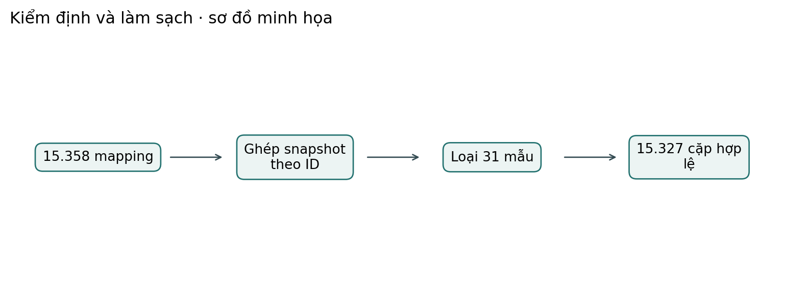

Cohort lưu serial_number, url, label, domain, html_sha256 và html_bytes. Feature matrix chỉ dùng ID để ghép; nhãn, địa chỉ, domain và hash không đi vào estimator. Notebook 04–05 dùng bộ thuộc tính đã kiểm định, notebook 06 xác minh hoặc khóa membership. Notebook 03 chỉ đọc Train đã khóa để làm EDA. Membership CV là ánh xạ bổ sung trong Train; Test không có fold.

Trong phiên Colab trước đó, mount hiển thị thư mục processed nhưng không đọc được cohort.csv; một lần kiểm tra Drive API trả 403 vì bộ lọc malware/spam. Quyền hiển thị có thể khác giữa các tài khoản. Khi gặp lỗi đọc được hỗ trợ, tuning_workspace tái tạo cohort trong runtime từ mapping, ZIP và danh sách ID đã khóa, rồi so SHA-256 với split lock. Mã đã xác minh là **ef1e5b04d40da1dfe6e37d71481ad40810fa2753b3e9fd78688bf4b5d99a0deb**. Chưa xác minh tính sẵn có lâu dài của tệp cho mọi tài khoản. Tài liệu phân phối ID và số liệu tổng hợp; các URL gốc chỉ dùng trong kho dữ liệu nghiên cứu được phép truy cập.

## 6. Khám phá dữ liệu trên Train

Train có 5.703 legitimate và 5.026 phishing. Validation và Test đều có 1.222 legitimate, 1.077 phishing (F03). Việc gần cân bằng trên corpus làm precision có thể khác đáng kể khi triển khai ở nơi tỷ lệ phishing thấp.

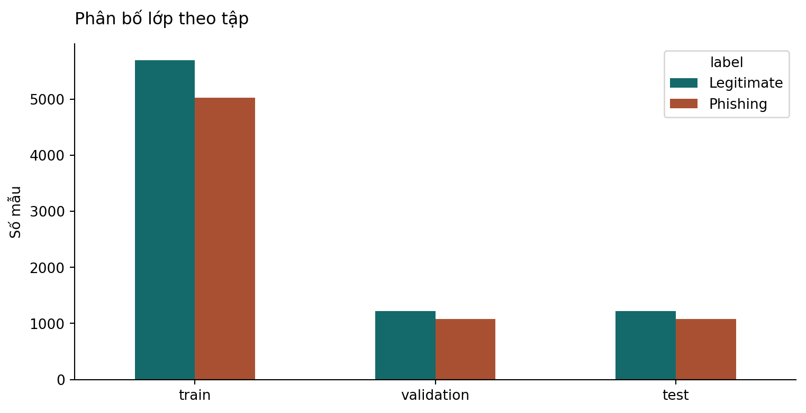

F04 thể hiện phân bố Train. Median độ dài URL tăng từ 24 lên 42 ký tự giữa hai lớp; median anchor_count giảm từ 127 xuống 1. Có 817 giá trị URL length ngoài hàng rào Tukey và không có giá trị thiếu ở 34 cột. Hàng rào Q1−1,5 IQR và Q3+1,5 IQR đánh dấu đuôi phân bố để đọc, không áp dụng cắt ngọn. Nhiều trang hợp lệ có cấu trúc phức tạp; mô hình có thể học shortcut “trang ít liên kết” trong corpus.

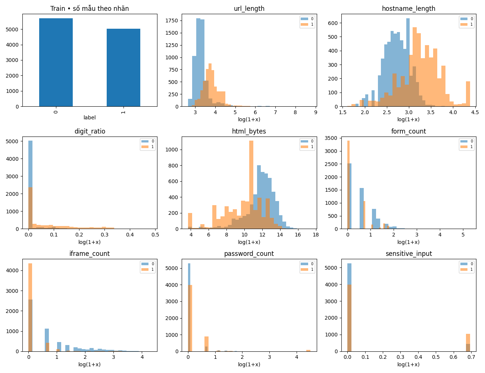

F05 là tương quan hạng Spearman. digit_count và digit_ratio đạt |ρ| = 0,995; password_count và sensitive_input đạt 0,978; tag_count và anchor_count đạt 0,915. Vì một tín hiệu có thể được chia giữa các biến tương quan, thứ hạng attribution riêng lẻ phụ thuộc cách biểu diễn. Mối tương quan với nhãn trong Train không chứng minh được quan hệ nhân quả.

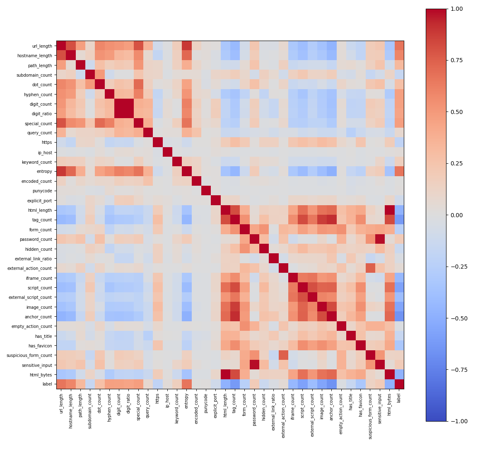

## 7. Kỹ thuật trích đặc trưng

Bảng T04 dưới đây theo đúng thứ tự schema 1.0.0. URL phải dùng HTTP(S), có hostname và port hợp lệ. Bộ phân tích PSL chạy offline, hỗ trợ private suffix. HTML được lxml phục hồi với mạng tắt; không mở iframe, CSS hay script. Đích tương đối được phân giải theo URL tài liệu hoặc base href hợp lệ. Mẫu số rỗng của tỷ lệ external links trả 0. Thiếu HTML tại inference kích hoạt đường URL-only; snapshot được gửi nhưng rỗng sinh lỗi đầu vào.

### Đặc trưng URL

|Biến (kiểu)|Cách tính|Ý nghĩa và giới hạn|
|---|---|---|
|url_length (int)|len(url), ký tự|Độ dài địa chỉ nhập. Không đo số byte.|
|hostname_length (int)|len(hostname)|Độ dài phần tên máy. Không phản ánh chủ sở hữu.|
|path_length (int)|len(path)|Độ dài đường dẫn gốc. Chưa giải mã phần trăm.|
|subdomain_count (int)|Số nhãn dưới registrable domain theo PSL|Mức phân cấp tên miền. IP nhận 0, phụ thuộc PSL đóng gói.|
|dot_count (int)|Đếm dấu chấm trên cả URL|Mật độ dấu phân cách. Tính cả path và query.|
|hyphen_count (int)|Đếm gạch nối trên cả URL|Cấu trúc tên và đường dẫn. Tên hợp lệ cũng dùng gạch nối.|
|digit_count (int)|Tổng ký tự thỏa isdigit|Số ký tự số. Gồm chữ số Unicode.|
|digit_ratio (float)|digit_count / url_length|Tỷ trọng chữ số. URL rỗng bị loại trước phép chia.|
|special_count (int)|Đếm ký tự không thỏa isalnum|Dấu câu và phân cách. Tính cả ký tự của scheme.|
|query_count (int)|Số cặp parse_qsl, giữ giá trị rỗng|Số tham số truy vấn. Khóa lặp được đếm nhiều lần.|
|https (binary)|scheme bằng https|Giao thức được khai báo. Không kiểm tra chứng thư.|
|ip_host (binary)|ipaddress nhận diện hostname|Địa chỉ IP trực tiếp. IP hợp lệ cũng phục vụ trang nội bộ.|
|keyword_count (int)|Tổng count của login, verify, secure, account, password, update, bank, signin trên URL chữ thường|Dấu hiệu từ vựng. Đếm chuỗi con, phụ thuộc ngôn ngữ.|
|entropy (float)|−Σ p(c) log₂ p(c), bit/ký tự|Đa dạng phân bố ký tự. Không xét thứ tự.|
|encoded_count (int)|Số chuỗi % kèm hai chữ số hex|Mức mã hóa URL. Mã hóa là hợp lệ.|
|punycode (binary)|Có nhãn hostname bắt đầu xn--|Dấu hiệu IDN dạng ASCII. Không phát hiện mọi tên gần giống.|
|explicit_port (binary)|urlsplit.port có giá trị|Cổng khai báo tường minh. Vẫn đếm khi là cổng mặc định.|

### Đặc trưng HTML

|Biến (kiểu)|Cách tính|Ý nghĩa và giới hạn|
|---|---|---|
|html_length (int)|len(html) sau giải mã|Quy mô snapshot. Không bằng kích thước ZIP.|
|tag_count (int)|Số node có tag kiểu str trong cây lxml|Độ phức tạp cây. Gồm node parser tự bổ sung.|
|form_count (int)|Số phần tử form|Sự hiện diện biểu mẫu. Không nói rõ mục đích.|
|password_count (int)|Số input có type password sau strip/lower|Điểm nhập mật khẩu. Đăng nhập hợp lệ cũng có.|
|hidden_count (int)|Số input có type hidden sau strip/lower|Trường ẩn trong biểu mẫu. Không kiểm tra CSS.|
|external_link_ratio (float)|Số đích anchor ngoài domain / max(1,số đích HTTP(S) hợp lệ)|Tỷ lệ liên kết ra ngoài. Không có link hợp lệ nhận 0.|
|external_action_count (int)|Số form có action HTTP(S) sang domain khác|Điểm gửi biểu mẫu. SSO hợp lệ có thể dùng domain khác.|
|iframe_count (int)|Số phần tử iframe|Nội dung nhúng. Không tải frame.|
|script_count (int)|Số phần tử script|Mức dùng mã script. Không thực thi mã.|
|external_script_count (int)|Số script src HTTP(S) ngoài registrable domain|Phụ thuộc ngoài trang. CDN cũng được đếm.|
|image_count (int)|Số phần tử img|Mật độ ảnh. Không tải ảnh.|
|anchor_count (int)|Số phần tử a|Mật độ điều hướng. Kể cả anchor thiếu href.|
|empty_action_count (int)|Số form thiếu action hoặc trống sau strip|Gửi về cùng tài liệu. Hợp lệ theo HTML.|
|has_title (binary)|Có title có văn bản sau strip|Metadata của trang. Không đánh giá nội dung.|
|has_favicon (binary)|Có link với token icon trong rel chữ thường|Khai báo biểu tượng. Không kiểm tra tài nguyên tồn tại.|
|suspicious_form_count (int)|Số form action khác domain hoặc có password và method GET, mặc định GET|Mẫu gửi dữ liệu đáng xem xét. Hai điều kiện trên một form chỉ đếm một lần.|
|sensitive_input (binary)|Có password, passwd, otp, cc-number, creditcard, ssn trong type/name/id/autocomplete|Dấu hiệu nhập dữ liệu nhạy cảm. Heuristic theo chuỗi con.|

## 8. Chia dữ liệu và kiểm soát rò rỉ

Tạo hai loại đỉnh cho registrable domain và SHA-256 HTML. Mỗi quan sát nối hai đỉnh, các đỉnh nối bắc cầu thuộc cùng thành phần. Trộn thứ tự bằng seed 2026 trước khi sắp nhóm giảm dần theo kích thước. Với mỗi nhóm, thử ba tập và chọn mức tăng sai số bình phương nhỏ nhất so với đích từng lớp 70/15/15, chuẩn hóa theo kích thước đích. Thành phần có thể chứa nhiều domain, nên chỉ tách riêng theo domain chưa đủ.

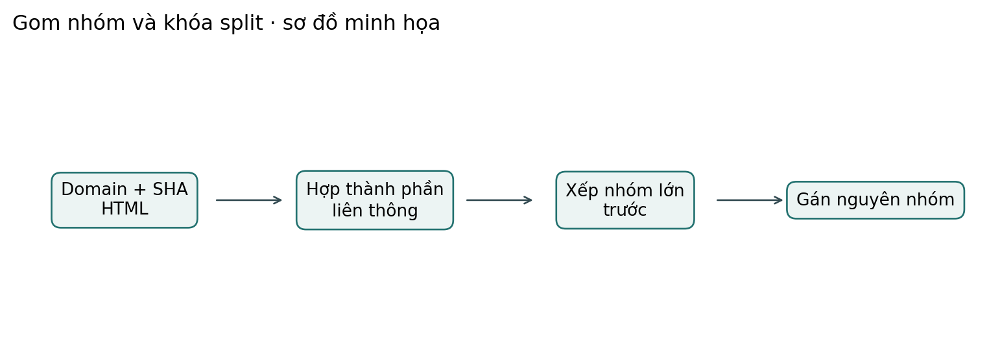

|Tập|Số mẫu|Nhóm|Nhóm lớn nhất|
|---|---|---|---|
|test|2299|1631|200|
|train|10729|7611|337|
|validation|2299|1631|220|

Trong Train, StratifiedGroupKFold có shuffle và seed 2026. Mỗi fold chứa 2.537 nhóm, nhưng fold 0 chỉ có 37,64% phishing so với 51,41% và 49,55% ở fold 1 và 2. Kích thước nhóm khác nhau giải thích vì sao cùng số nhóm vẫn khác số hàng và tỷ lệ lớp. F2 OOF được tính sau khi gộp mọi dự đoán một lần cho mỗi hàng Train; trung bình ba F2 theo fold là đại lượng khác. Kiểm toán không phát hiện giao URL, domain hoặc exact HTML hash qua split. Near-duplicate, nội dung động và chiến dịch chung vẫn là nguồn phụ thuộc.

## 9. Random Forest

Mỗi cây CART chia nút theo giảm độ hỗn tạp Gini, với $G=1-\sum_k p_k^2$. Tại một nút, chỉ một tập con ngẫu nhiên của biến được xét. Bootstrap lấy mẫu hàng có hoàn lại; việc trung bình các cây làm giảm phương sai khi lỗi giữa cây không đồng biến hoàn toàn. Với T cây, điểm lớp phishing là trung bình tỷ phần lớp có trọng số trong các lá tương ứng.

$$s(x)=\frac{1}{T}\sum_{j=1}^{T}p_j(1\mid x),\qquad \hat y=\mathbf{1}[s(x)\geq t].$$

n_estimators điều chỉnh độ ổn định và chi phí; max_depth, min_samples_split và min_samples_leaf giới hạn độ chi tiết phân hoạch. max_features điều chỉnh tương quan giữa các cây. class_weight thay đổi trọng số lớp khi học; random_state điều khiển bootstrap và lấy mẫu biến. V1 dùng 200 cây, lá tối thiểu 2, trọng số balanced; cả hai V2 dùng 300 cây. URL-only chọn depth 10 và leaf 4, URL+HTML giữ depth không giới hạn và leaf 2. Đây là kết quả của tìm kiếm cả cấu hình (T14). Triển khai scikit-learn dùng CPU song song.

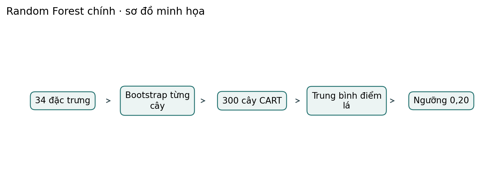

## 10. XGBoost

Với nhãn nhị phân, mỗi vòng cộng một cây vào logit $z_t=z_{t-1}+\eta f_t(x)$; sigmoid biến logit thành điểm. Logistic loss có gradient $g_i=p_i-y_i$ và Hessian $h_i=p_i(1-p_i)$. Xấp xỉ bậc hai trong một vòng cho phép cộng gradient và Hessian trong mỗi bin histogram. Với lá có tổng G, H và L1 bằng 0, trọng số tối ưu là $-G/(H+\lambda)$. gamma tạo chi phí cho lá, reg_alpha tạo phạt L1, min_child_weight giới hạn Hessian tối thiểu của lá con.

$$\mathcal L_t\approx\sum_i[g_if_t(x_i)+\tfrac12 h_i f_t(x_i)^2]+\gamma L+\tfrac{\lambda}{2}\sum_j w_j^2+\alpha\sum_j|w_j|.$$

V1 dùng 250 vòng, depth 5 và η = 0,06. URL-only V2 chọn 100 vòng với depth 3, gamma 0,5, α = 0,1, λ = 10. URL+HTML chọn 300 vòng, giữ depth 5. Hai modality dùng hist, subsample và colsample_bytree bằng 1. Cùng đầu vào, không lấy mẫu hàng/cột làm ba seed có thể cho cùng cây. Bảng integrity lưu hash tree dump, hash vector dự đoán Validation và attempt của từng lần fit. CPU là môi trường đã đo; không có benchmark GPU đối chứng.

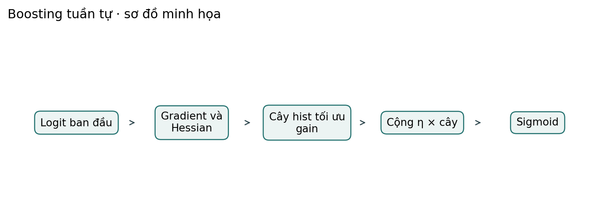

## 11. Mạng nơron MLP

Đầu vào 17 hoặc 34 chiều được chuẩn hóa $z_j=(x_j-\mu_j)/\sigma_j$ bằng StandardScaler chỉ fit trên phần học tương ứng. Mạng có đúng một hidden layer, $h=\max(0,W_1z+b_1)$; dropout chỉ tác động khi train. Logit $a=W_2h+b_2$ đi vào BCEWithLogitsLoss. Loss một mẫu là $\log(1+\exp(a))-ya$ với cách tính số ổn định. Backpropagation truyền gradient qua linear và ReLU; Adam thích nghi bước theo hai moment gradient.

Baseline dùng width 64, batch 128, learning rate 0,001 và tối đa 80 epoch. Cả hai V2 chọn width 256, batch 64, learning rate 0,0005, dropout 0,1, weight decay 0,001 và trần 150 epoch. Patience 8 tính từ lần giảm validation loss gần nhất. Trong outer CV, tập dừng thuộc outer-train; ví dụ C021 URL+HTML fold 0 có 5.379 hàng fit, 2.316 hàng dừng, 3.034 hàng outer-validation. Không refit sau khi dừng. Final training dùng Train và Validation chính thức; scaler và trọng số tốt nhất được đóng gói để suy luận NumPy CPU. Hình F14 cho thấy loss của một run thực tế; khoảng cách loss train–validation là chẩn đoán trên run đó.

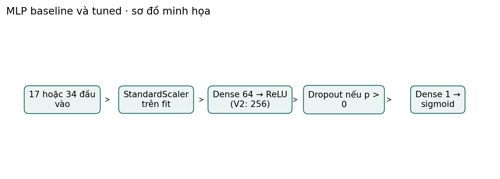

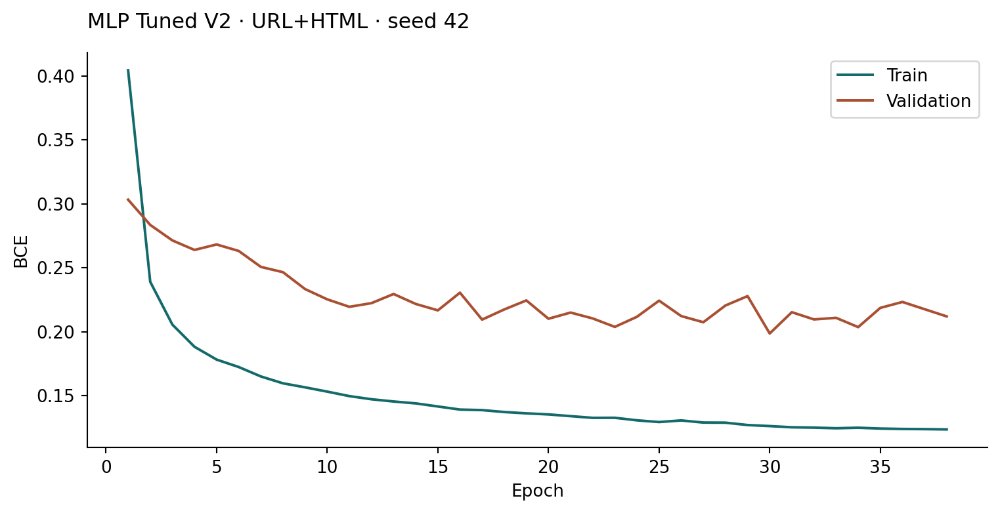

## 12. Ma trận thực nghiệm

Ba họ × hai modality × ba seed tạo 18 baseline và 18 tuned run riêng biệt. CV có 144 candidate × 3 outer folds = 432 lượt đánh giá có một lần fit ngoài cho mỗi lượt theo implementation. Inner stopping của MLP chia dữ liệu trong lượt fit, không train ba mạng để lấy trung bình. Cộng 36 final fits và 432 CV fits được 468 lần fit theo thiết kế, chưa kể smoke/hardware probe và lần chạy dở nếu có. Con số này không xác định số job thực sự từng khởi động.

Seed split/search/CV là 2026 cho ba vai trò khác nhau. Seed tuning là 42, seed final là 42/43/44. Giữ nguyên split cho phép ghép theo seed khi so sánh; ba lần chạy không cung cấp ba Test độc lập. T07 ghi thiết bị, số lõi và phiên bản phần mềm từ manifest chứ không suy từ tên notebook.

## 13. Cấu hình baseline

|Họ|Tham số|Giá trị baseline|
|---|---|---|
|random_forest|n_estimators|200|
|random_forest|min_samples_leaf|2|
|random_forest|n_jobs|-1|
|random_forest|class_weight|balanced|
|xgboost|n_estimators|250|
|xgboost|learning_rate|0.06|
|xgboost|max_depth|5|
|xgboost|tree_method|hist|
|xgboost|eval_metric|logloss|
|xgboost|n_jobs|2|
|mlp|hidden|64|
|mlp|batch_size|128|
|mlp|epochs|80|
|mlp|patience|8|
|mlp|learning_rate|0.001|

Các giá trị mặc định thư viện có hiệu lực được lưu ở results/baseline_v1/effective_parameters.json. RF và XGBoost dùng feature matrix số trực tiếp. MLP sử dụng scaler riêng từng fit. Mọi so sánh ở V1 dùng cùng ngưỡng chọn theo quy tắc Validation; mỗi checkpoint vẫn có thể nhận ngưỡng khác nhau.

## 14. Thiết kế tìm kiếm siêu tham số

Với mỗi model/modality, liệt kê controlled sweep trên một trục ở cấu hình nền, sau đó rút ngẫu nhiên các tọa độ rời rạc bằng seed 2026 tới đủ 24 tổ hợp duy nhất. Các modality của cùng thuật toán có cùng danh sách candidate. Chỉ Train tham gia CV. Ở mỗi candidate, xác định t trên pooled OOF bằng cùng lưới 19 ngưỡng, sau đó xếp theo F2, precision, FPR thấp, ưu tiên cấu hình nền khi hòa, cuối cùng ID nhỏ hơn. T09 ghi các giá trị được phép, T13 có kết quả của đủ 144 candidate và T14 nối từng tham số với lock.

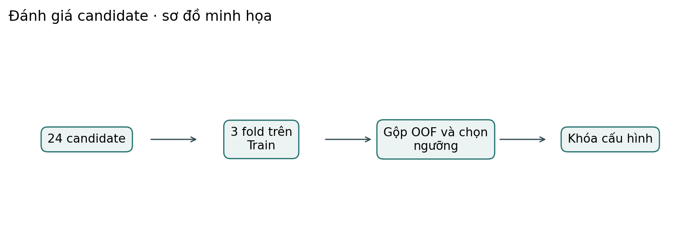

Khi so nhiều candidate trên cùng OOF, điểm tốt nhất có thể lạc quan đối với dữ liệu khác. Validation vẫn có vai trò riêng ở lần fit sau, còn checkpoint đánh Test chỉ được xác định sau khi tổng hợp ba seed. SHA-256 trong lock ràng buộc code ảnh hưởng kết quả, CV, danh sách candidate và artifact từng trial.

## 15. Phân tích độ nhạy

RF URL+HTML trong sweep đạt lần lượt F2 OOF 0,9558; 0,9567; 0,9563; 0,9574; 0,9570 khi dùng 50/100/200/300/500 cây. Thêm 200 cây sau mốc 300 tăng công việc nhưng không cải thiện F2 ở sweep này. Với URL-only, 200 và 500 cây đều xấp xỉ 0,9040. Hai candidate thắng có 300 cây cùng những giá trị khác, nên không thể gán toàn bộ gain cho số cây.

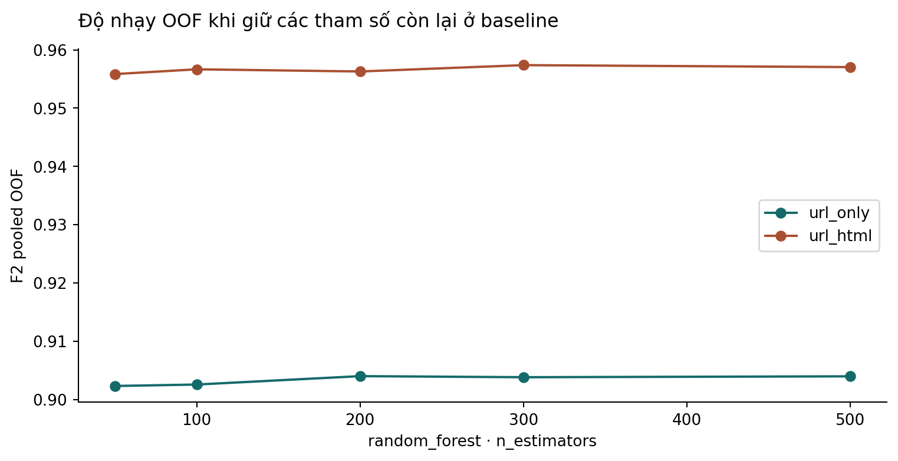

XGBoost URL-only đạt 0,9050 ở 100 vòng, xuống 0,8980 ở 500; selection C006 đồng thời đổi độ sâu và regularization. Với URL+HTML, controlled candidate C004 300 vòng đạt khoảng 0,9520, hơn 250 vòng (0,9508). Tác động phụ thuộc modality và tiêu chí OOF, không phải quy luật càng nhiều vòng càng tốt.

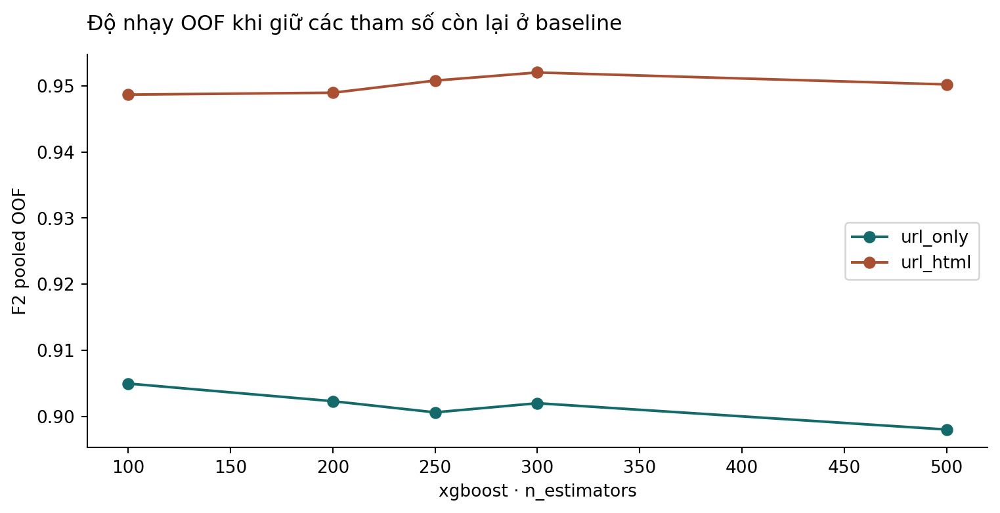

MLP URL+HTML tăng từ 0,9267 lên 0,9323 khi width tăng từ 32 lên 256 trong sweep. C021 đồng thời thay batch, learning rate, dropout và weight decay. Không có đối chứng cô lập riêng từng biến trong toàn bộ random search. Các chỉ tiêu precision, recall, FPR, loss, thời gian và kích thước có trong T13 và sensitivity.csv của từng cặp.

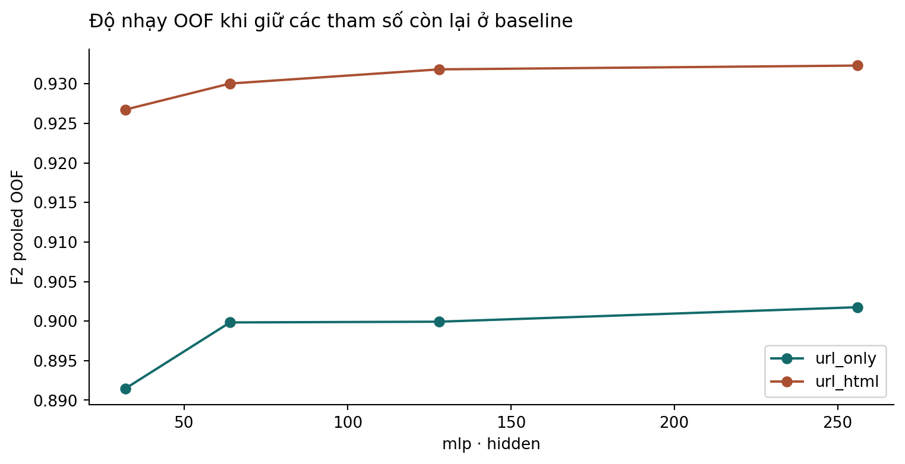

Bảng T13 cho thấy, với RF URL-only, tổ hợp winner giới hạn độ sâu và tăng tối thiểu số mẫu lá. Với HTML, C019 giữ lá tối thiểu hai mẫu. max_features điều chỉnh tương quan giữa cây và chi phí tìm split. Tác động riêng của depth, leaf và sampling chưa được tách khỏi những thay đổi khác ở hai winner. Ở XGBoost, giảm learning rate làm mỗi cây đóng góp ít hơn vào logit; max_depth, gamma, L1 và L2 đồng thời giới hạn cấu trúc hoặc trọng số lá. Đối với hai winner, subsample và colsample_bytree đều bằng 1. Nghiên cứu không cô lập được hiệu ứng nhân quả riêng của từng tham số này.

Ở C021, MLP đổi đồng thời kích thước batch, tốc độ học, dropout và weight decay. Ba fold URL-only có best epoch lần lượt 38, 44 và 57, dừng sau 46, 52 và 65 epoch. Các giá trị tương ứng ở URL+HTML là 38, 47 và 57, dừng sau 46, 55 và 65. Trần 150 epoch không phải số epoch thực chạy. Patience 8 và tập dừng trong outer-train giải thích khoảng cách giữa best epoch và epoch cuối.

## 16. Từ baseline tới candidate thắng

T14 ghi đủ tham số gốc, miền tìm kiếm, giá trị đã chọn, trạng thái thay đổi và ID bằng chứng. Sáu bảng dưới trình bày baseline candidate và winner của từng cặp; giá trị F2, precision, recall và FPR dùng cùng một tập OOF trong từng cặp. Các cột có giá trị đơn là điều khiển cố định. Bảng chi tiết bổ sung mặc định thư viện trong reports/experiments/hyperparameter_comparison.md.

### random_forest · url_only · C022

|Tham số|V1|V2|Không gian|
|---|---|---|---|
|n_estimators|200|300|[50, 100, 200, 300, 500]|
|min_samples_leaf|2|4|[1, 2, 4, 8]|
|n_jobs|-1|-1|[-1]|
|class_weight|balanced|null|[null, balanced]|
|max_depth|null|10|[10, 20, 30, null]|
|max_features|sqrt|log2|[sqrt, log2, 0.5]|
|min_samples_split|2|5|[2, 5, 10]|

OOF của C022 đạt F2 90.847%, Recall 95.066%, FPR 24.812%, ngưỡng 0.15. T13 lưu các kết quả của cả 24 candidate.

Chi phí fit qua ba fold: 6.68 s (C003) và 7.29 s (C022). Hiệu F2 OOF là +0.444 đpt. Đối chiếu OOF. Trong mỗi cột, thứ tự là baseline C003 → winner C022.

|F2 (%)|Precision (%)|Recall (%)|FPR (%)|
|---|---|---|---|
|90.403 → 90.847|82.132 → 77.152|92.738 → 95.066|17.780 → 24.812|

### random_forest · url_html · C019

|Tham số|V1|V2|Không gian|
|---|---|---|---|
|n_estimators|200|300|[50, 100, 200, 300, 500]|
|min_samples_leaf|2|2|[1, 2, 4, 8]|
|n_jobs|-1|-1|[-1]|
|class_weight|balanced|null|[null, balanced]|
|max_depth|null|null|[10, 20, 30, null]|
|max_features|sqrt|log2|[sqrt, log2, 0.5]|
|min_samples_split|2|5|[2, 5, 10]|

OOF của C019 đạt F2 95.754%, Recall 97.632%, FPR 10.731%, ngưỡng 0.25. T13 lưu các kết quả của cả 24 candidate.

Chi phí fit qua ba fold: 4.73 s (C003) và 6.96 s (C019). Hiệu F2 OOF là +0.125 đpt. Đối chiếu OOF. Trong mỗi cột, thứ tự là baseline C003 → winner C019.

|F2 (%)|Precision (%)|Recall (%)|FPR (%)|
|---|---|---|---|
|95.629 → 95.754|88.770 → 88.911|97.513 → 97.632|10.871 → 10.731|

### xgboost · url_only · C006

|Tham số|V1|V2|Không gian|
|---|---|---|---|
|n_estimators|250|100|[100, 200, 250, 300, 500]|
|learning_rate|0.06|0.06|[0.01, 0.03, 0.06, 0.1]|
|max_depth|5|3|[3, 5, 7, 9]|
|tree_method|hist|hist|[hist]|
|eval_metric|logloss|logloss|[logloss]|
|n_jobs|2|2|[2]|
|min_child_weight|1|1|[1, 3, 5]|
|subsample|1.0|1.0|[0.7, 0.8, 1.0]|
|colsample_bytree|1.0|1.0|[0.7, 0.8, 1.0]|
|gamma|0|0.5|[0, 0.1, 0.5]|
|reg_alpha|0|0.1|[0, 0.1, 1]|
|reg_lambda|1|10|[0.1, 1, 5, 10]|

OOF của C006 đạt F2 90.611%, Recall 95.006%, FPR 25.776%, ngưỡng 0.15. T13 lưu các kết quả của cả 24 candidate.

Chi phí fit qua ba fold: 2.18 s (C003) và 0.17 s (C006). Hiệu F2 OOF là +0.547 đpt. Đối chiếu OOF. Trong mỗi cột, thứ tự là baseline C003 → winner C006.

|F2 (%)|Precision (%)|Recall (%)|FPR (%)|
|---|---|---|---|
|90.064 → 90.611|76.009 → 76.461|94.429 → 95.006|26.267 → 25.776|

### xgboost · url_html · C004

|Tham số|V1|V2|Không gian|
|---|---|---|---|
|n_estimators|250|300|[100, 200, 250, 300, 500]|
|learning_rate|0.06|0.06|[0.01, 0.03, 0.06, 0.1]|
|max_depth|5|5|[3, 5, 7, 9]|
|tree_method|hist|hist|[hist]|
|eval_metric|logloss|logloss|[logloss]|
|n_jobs|2|2|[2]|
|min_child_weight|1|1|[1, 3, 5]|
|subsample|1.0|1.0|[0.7, 0.8, 1.0]|
|colsample_bytree|1.0|1.0|[0.7, 0.8, 1.0]|
|gamma|0|0|[0, 0.1, 0.5]|
|reg_alpha|0|0|[0, 0.1, 1]|
|reg_lambda|1|1|[0.1, 1, 5, 10]|

OOF của C004 đạt F2 95.201%, Recall 98.448%, FPR 16.395%, ngưỡng 0.05. T13 lưu các kết quả của cả 24 candidate.

Chi phí fit qua ba fold: 0.87 s (C003) và 1.03 s (C004). Hiệu F2 OOF là +0.122 đpt. Đối chiếu OOF. Trong mỗi cột, thứ tự là baseline C003 → winner C004.

|F2 (%)|Precision (%)|Recall (%)|FPR (%)|
|---|---|---|---|
|95.079 → 95.201|83.289 → 84.107|98.567 → 98.448|17.429 → 16.395|

### mlp · url_only · C021

|Tham số|V1|V2|Không gian|
|---|---|---|---|
|hidden|64|256|[32, 64, 128, 256]|
|batch_size|128|64|[32, 64, 128, 256]|
|epochs|80|150|[80, 150, 200]|
|patience|8|8|[8]|
|learning_rate|0.001|0.0005|[0.0001, 0.0005, 0.001]|
|weight_decay|0|0.001|[0, 0.0001, 0.001]|
|dropout|0|0.1|[0, 0.1, 0.3]|

OOF của C021 đạt F2 90.243%, Recall 94.767%, FPR 26.705%, ngưỡng 0.15. T13 lưu các kết quả của cả 24 candidate.

Chi phí fit qua ba fold: 18.98 s (C002) và 34.45 s (C021). Hiệu F2 OOF là +0.259 đpt. Đối chiếu OOF. Trong mỗi cột, thứ tự là baseline C002 → winner C021.

|F2 (%)|Precision (%)|Recall (%)|FPR (%)|
|---|---|---|---|
|89.983 → 90.243|76.240 → 75.772|94.230 → 94.767|25.881 → 26.705|

### mlp · url_html · C021

|Tham số|V1|V2|Không gian|
|---|---|---|---|
|hidden|64|256|[32, 64, 128, 256]|
|batch_size|128|64|[32, 64, 128, 256]|
|epochs|80|150|[80, 150, 200]|
|patience|8|8|[8]|
|learning_rate|0.001|0.0005|[0.0001, 0.0005, 0.001]|
|weight_decay|0|0.001|[0, 0.0001, 0.001]|
|dropout|0|0.1|[0, 0.1, 0.3]|

OOF của C021 đạt F2 93.471%, Recall 97.533%, FPR 21.322%, ngưỡng 0.1. T13 lưu các kết quả của cả 24 candidate.

Chi phí fit qua ba fold: 21.57 s (C002) và 35.20 s (C021). Hiệu F2 OOF là +0.467 đpt. Đối chiếu OOF. Trong mỗi cột, thứ tự là baseline C002 → winner C021.

|F2 (%)|Precision (%)|Recall (%)|FPR (%)|
|---|---|---|---|
|93.004 → 93.471|81.407 → 80.124|96.439 → 97.533|19.411 → 21.322|

Bảng T14 đánh dấu changed theo từng tham số và ghi đường dẫn tuning_lock.json. Mỗi tiêu đề ở trên nhận diện trial thắng trong đúng cặp. Thời gian candidate là tổng các lần fit và ghi checkpoint qua ba fold.

## 17. Chỉ số và điểm vận hành

Lớp dương là phishing. TP và TN là dự đoán đúng của hai lớp. FP là legitimate bị cảnh báo, FN là phishing lọt qua. Độ chính xác chung bằng (TP+TN)/N; precision đo độ tin cậy của cảnh báo, recall đo tỷ lệ bắt được trong các trang phishing. FPR = FP/(FP+TN) và FNR = FN/(FN+TP). Khi prevalence thay đổi, cùng TPR/FPR vẫn có thể cho precision khác.

$$P=\frac{TP}{TP+FP},\quad R=\frac{TP}{TP+FN},\quad F_\beta=\frac{(1+\beta^2)PR}{\beta^2P+R}.$$

Với β = 2, $F_2=5TP/(5TP+4FN+FP)$ đặt trọng số lớn hơn lên bỏ sót. F1 dùng β = 1; macro-F1 trung bình F1 của cả hai lớp. ROC-AUC đo thứ tự điểm qua các ngưỡng; PR-AUC của dự án tích phân hình thang đường precision–recall, còn average precision dùng tổng precision nhân bước tăng recall. Các chỉ số diện tích dùng điểm liên tục. Không thể đọc số cảnh báo nhầm tại ngưỡng triển khai chỉ từ AUC.

Specificity = TN/(TN+FP) = 1 − FPR. Ở Test, 1.075/1.222 trang hợp lệ được nhận đúng, tương ứng 87,97%.

## 18. Chọn ngưỡng

Trên Validation, mỗi run tìm F2 lớn nhất trong t = 0,05 đến 0,95, bước 0,05. Khi hòa, chọn precision cao hơn, FPR thấp hơn và cuối cùng ngưỡng cao hơn. Với RF seed 43, tăng ngưỡng từ 0,15 lên 0,20 làm recall giảm từ 98,33% xuống 97,77% nhưng precision tăng từ 86,24% lên 89,39%. F2 đạt 95,97% tại 0,20 rồi giảm xuống 95,69% tại 0,25. Với fallback, ngưỡng thuộc run URL-only seed 44 là 0,15. Hình F21 dùng cùng checkpoint trên Validation; các ngưỡng Test không được khảo sát để thay đổi quyết định.

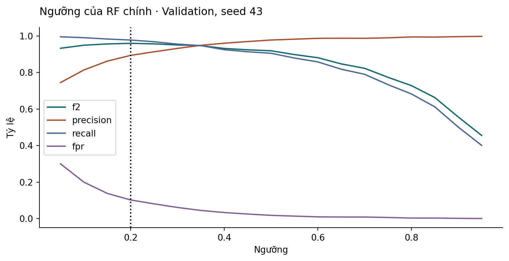

Ngưỡng mặc định 0,5 tương ứng với một quy tắc quyết định khác. Lưới Validation phản ánh ưu tiên F2 của nhóm trước khi phê duyệt Test.

## 19. Kết quả baseline trên Validation

|Họ|Đầu vào|F2 ± SD (%)|Recall (%)|FPR (%)|
|---|---|---|---|---|
|mlp|url_html|94.374 ± 0.341|96.874|14.430|
|mlp|url_only|87.775 ± 0.431|90.746|23.077|
|random_forest|url_html|95.810 ± 0.140|97.400|9.602|
|random_forest|url_only|89.805 ± 0.147|94.212|26.732|
|xgboost|url_html|96.048 ± 0.000|97.493|8.838|
|xgboost|url_only|89.760 ± 0.000|93.593|24.468|

XGBoost URL+HTML cho F2 trung bình 96,048% và FPR 8,838%, tốt nhất trong sáu nhóm V1 theo F2. RF URL+HTML đứng gần với 95,810%; MLP URL+HTML 94,374%. Trong URL-only, RF đạt 89,805%, XGBoost 89,760% và MLP 87,775%. Ba seed XGBoost có F2 trùng nhau, nhưng registry lưu ba attempt độc lập. T11 và T12 lưu từng seed, sample SD, min và max của tất cả metric. Chỉ nên đọc độ lệch chuẩn như độ nhạy của thuật toán đối với seed trên split này.

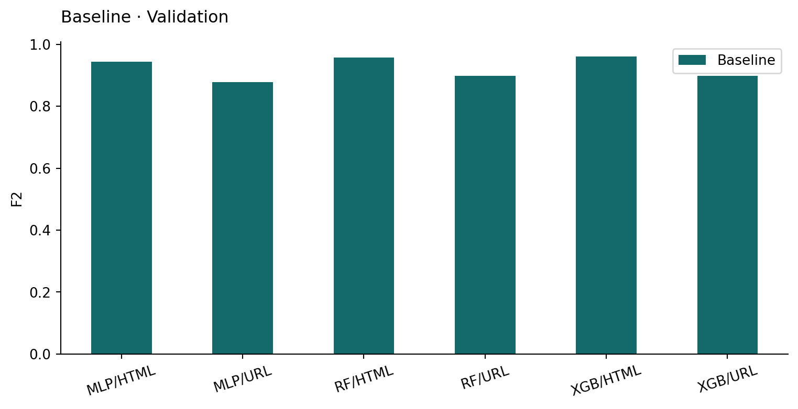

## 20. Kết quả tuned trên Validation

|Họ|Đầu vào|F2 ± SD (%)|Recall (%)|FPR (%)|
|---|---|---|---|---|
|mlp|url_html|94.850 ± 0.091|97.586|14.839|
|mlp|url_only|87.657 ± 0.144|90.994|24.714|
|random_forest|url_html|95.920 ± 0.057|97.648|10.011|
|random_forest|url_only|89.707 ± 0.062|93.005|22.368|
|xgboost|url_html|95.900 ± 0.000|97.307|8.838|
|xgboost|url_only|88.736 ± 0.000|94.800|34.697|

RF URL+HTML đạt 95,920%, XGBoost URL+HTML 95,900%, cách nhau xấp xỉ 0,020 đpt. RF có recall cao hơn, XGBoost có precision cao hơn và FPR thấp hơn. Thứ tự lựa chọn phụ thuộc mục tiêu F2; một tổ chức tốn nhiều chi phí xử lý cảnh báo nhầm có thể đánh giá trade-off khác ở một giao thức mới. Trong so sánh V1/V2, bốn cặp giảm F2. XGBoost URL-only giảm 1,023 đpt và FPR tăng 10,229 đpt, mặc dù candidate thắng OOF. Với RF URL-only, F2 giảm 0,098 đpt nhưng FPR giảm 4,364 đpt. F17 và F18 cần đọc cùng nhau.

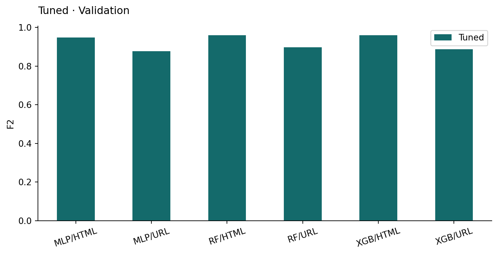

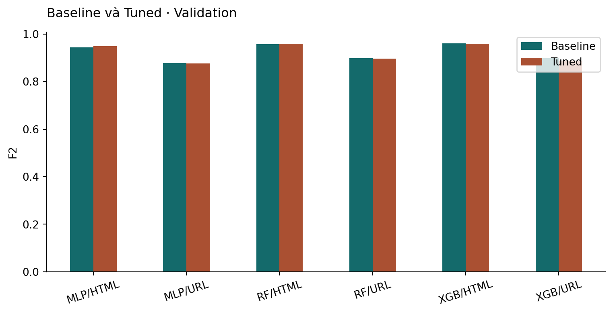

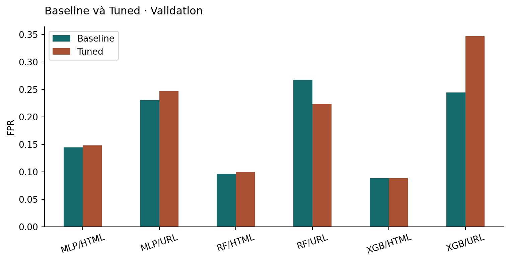

## 21. Ablation URL và HTML

|Pha|Họ|URL (%)|URL+HTML (%)|Δ F2 (đpt)|
|---|---|---|---|---|
|Baseline|mlp|87.775|94.374|+6.599|
|Baseline|random_forest|89.805|95.810|+6.005|
|Baseline|xgboost|89.760|96.048|+6.289|
|Tuned|mlp|87.657|94.850|+7.193|
|Tuned|random_forest|89.707|95.920|+6.213|
|Tuned|xgboost|88.736|95.900|+7.164|

Ở baseline, trong cùng thuật toán và seed, cấu hình đã chỉ định được giữ cố định. HTML bổ sung từ 6,005 đến 6,599 đpt F2 trung bình. Đầu vào rộng hơn cũng làm thay đổi không gian biểu diễn và có thể thay số biến cây xem xét ở mỗi split, nên đây là lợi ích của toàn bộ pipeline URL+HTML. Ở V2, chênh lệch bao gồm cả tuning khác nhau. T18 báo cả thay đổi tuyệt đối và tương đối của precision, recall, FPR và ROC-AUC. Một mức tăng 6 đpt từ mức 90% tương đương khoảng 6,7% so với mức ban đầu.

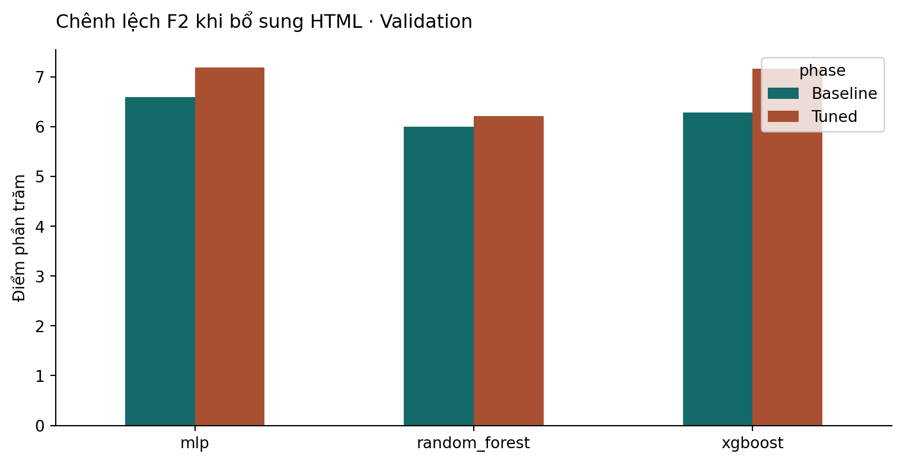

## 22. Phân tích thống kê ghép cặp

Với model và modality cố định, đặt $d_s=M_{V2,s}-M_{V1,s}$. Trung bình $\bar d=\sum d_s/3$ và độ lệch chuẩn mẫu $s_d=\sqrt{\sum(d_s-\bar d)^2/2}$. Khi hai phương pháp có tương quan do dùng chung split, ghép theo seed giữ cấu trúc đối chiếu. T17 ghi từng hiệu; T19 ghi trung bình, SD, min, max và phần trăm tương đối. Hình F19 cho biết biến thiên giữa seed, không đo bất định khi lấy mẫu website mới.

|Họ|Đầu vào|Δ F2 (đpt)|SD (đpt)|Min / max (đpt)|
|---|---|---|---|---|
|mlp|url_html|+0.476|0.251|0.246 / 0.744|
|mlp|url_only|-0.118|0.438|-0.552 / 0.325|
|random_forest|url_html|+0.110|0.088|0.049 / 0.210|
|random_forest|url_only|-0.098|0.119|-0.210 / 0.027|
|xgboost|url_html|-0.148|0.000|-0.148 / -0.148|
|xgboost|url_only|-1.023|0.000|-1.023 / -1.023|

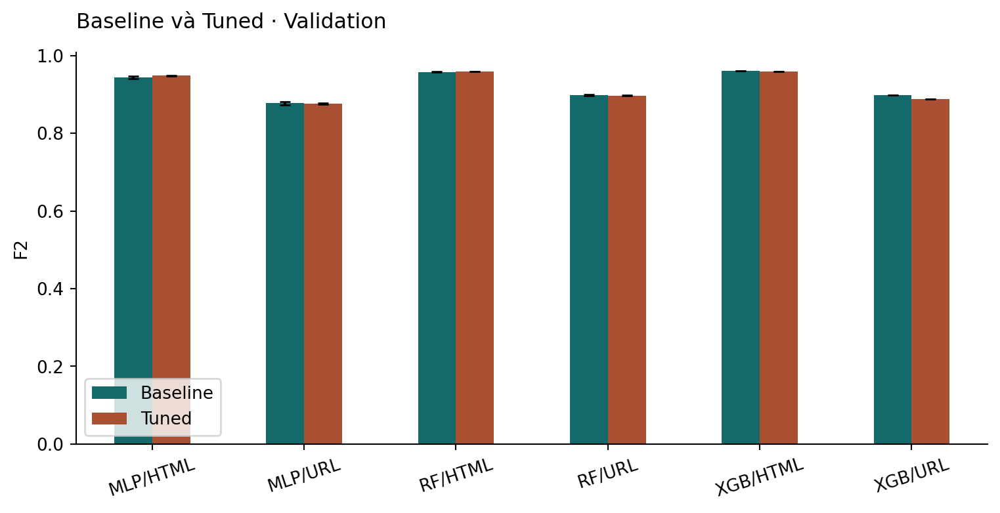

Thiết kế không cung cấp ba phép thử tổng quát hóa độc lập. Không suy ra p-value từ ba seed và không coi khoảng ±SD là khoảng tin cậy. Một giao thức ngoài mẫu tương lai có thể bootstrap theo connected component hoặc campaign, đồng thời ghi nhận nhóm rất lớn làm khoảng ước lượng rộng hơn. Phân tích này không dùng bootstrap để xếp lại mô hình.

## 23. Khóa lựa chọn và đánh giá Test

Từ sáu cặp V2, quy tắc chọn lần lượt theo mean F2 giảm dần, mean precision giảm dần, mean FPR tăng dần, tên model và modality. Trong nhóm thắng chọn run theo F2, precision, FPR và seed nhỏ hơn nếu vẫn hòa. Việc xem XGBoost baseline có F2 cao hơn RF tuned không làm thay tập ứng viên V2 sau Test. Candidate thắng CV mới xác định hyperparameter; việc chọn họ mô hình và chọn checkpoint dùng các đối tượng khác nhau.

Primary RF URL+HTML C019, seed 43, 300 cây và ngưỡng 0,20. Fallback RF URL-only C022, seed 44, 300 cây và ngưỡng 0,15. SHA-256 selection *a0d5100ce5866e8281699795d27adf13caddb219b41aa94e65fb25eaa4bff606* khớp phê duyệt. Bước Test xác minh checkpoint, nguồn huấn luyện và threshold trước khi đọc holdout. F22–F24 là ba cách nhìn cùng 2.299 dự đoán của **primary**.

|Chỉ số|Locked Test (%)|
|---|---|
|accuracy|92.866|
|precision|87.821|
|recall|98.422|
|f1|92.820|
|f2|96.102|
|macro_f1|92.866|
|roc_auc|98.979|
|pr_auc|98.948|
|average_precision|98.948|
|fpr|12.029|
|fnr|1.578|

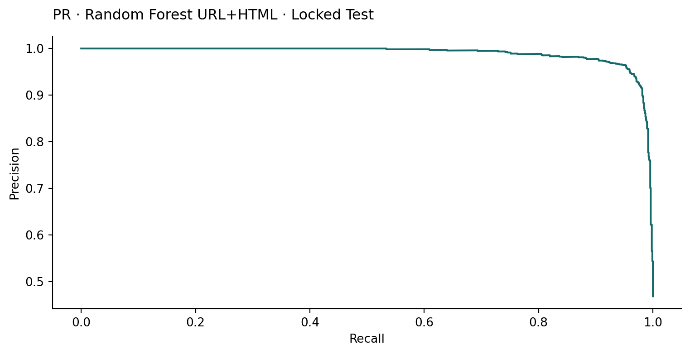

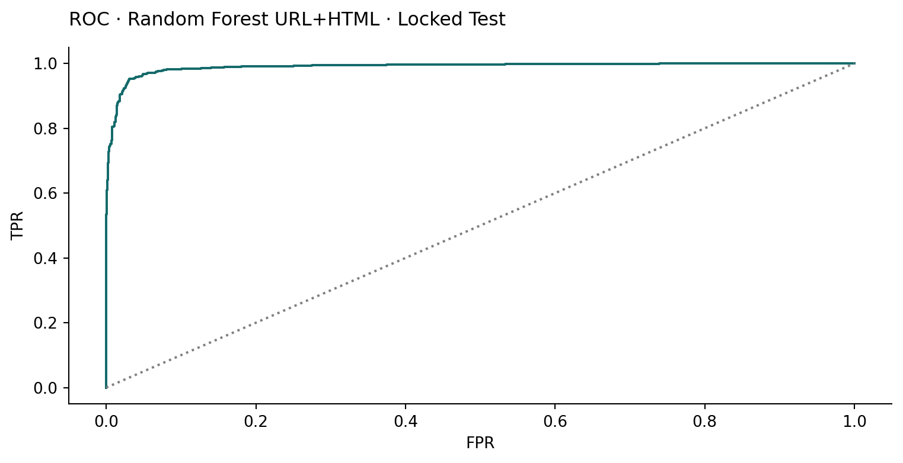

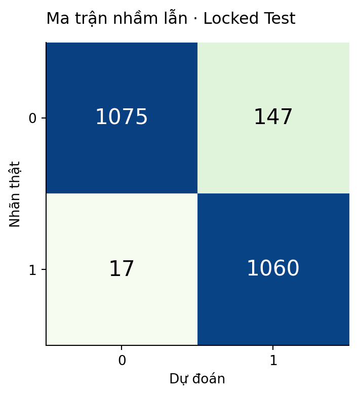

Lỗi bỏ sót ảnh hưởng trực tiếp khả năng bảo vệ người dùng. Cảnh báo nhầm có thể làm người dùng bỏ qua các cảnh báo sau. Không có phép đối chiếu XGBoost hay fallback trên Test; phép so sánh mô hình trong báo cáo chỉ dùng Validation.

## 24. SHAP và diễn giải tiếng Việt

Shapley value phân bổ chênh lệch giữa kỳ vọng nền và một đầu ra bằng cách trung bình đóng góp cận biên của biến j trên các tập con S. Với m biến, trọng số phụ thuộc kích thước S.

$$\phi_j=\sum_{S\subseteq N\setminus\{j\}}\frac{|S|!(m-|S|-1)!}{m!}[v(S\cup\{j\})-v(S)].$$

Notebook 11 gọi giải thích permutation với seed 42, tối đa 3(2m+1) lần đánh giá cho mỗi mẫu; 32 hàng Train làm nền, 24 hàng Validation để minh họa. Hàm mục tiêu là điểm lớp phishing. T23 xếp mean absolute contribution; anchor_count 0,1040, url_length 0,0576 và hostname_length 0,0526 đứng đầu. Cột được tô theo giá trị trong beeswarm F25, vị trí ngang cho biết dấu và độ lớn đóng góp. Thứ hạng này mô tả 24 hàng đã chọn và background cụ thể.

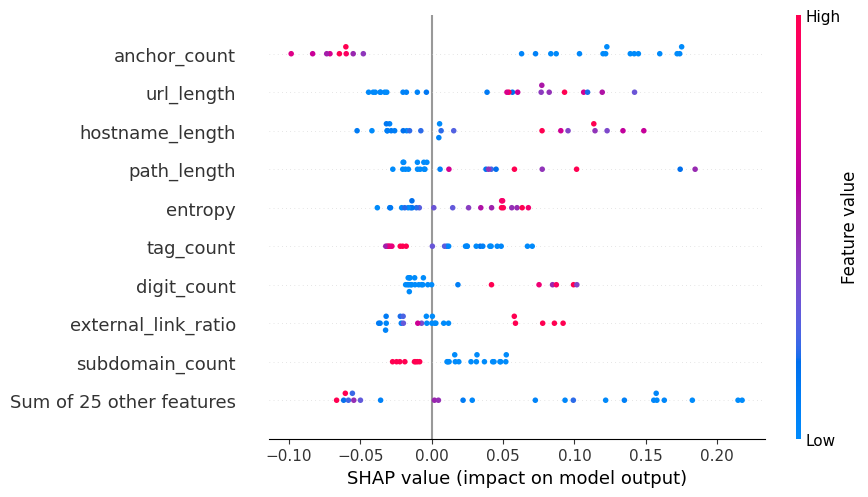

Phân tích cục bộ đối chiếu tổng đóng góp với điểm dự đoán trên Validation. Bản nội bộ của nhóm lưu các ví dụ theo ID. Bảng công khai tổng hợp đóng góp theo đặc trưng.

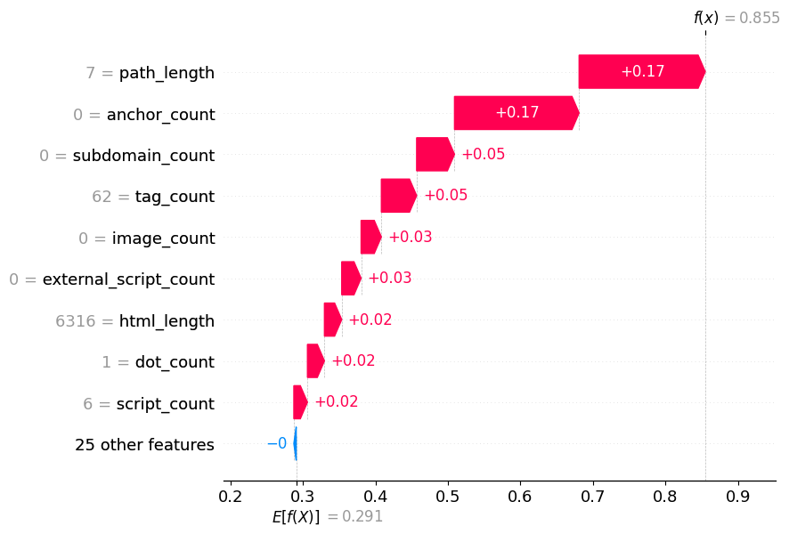

API dùng cách khác. Bắt đầu từ vector trung vị Train, thay từng biến bằng giá trị của mẫu theo thứ tự schema, lấy hiệu điểm liên tiếp. Tổng mọi hiệu bằng chênh lệch hai điểm đầu/cuối; API chỉ hiển thị tối đa năm hiệu có trị tuyệt đối lớn nhất. Thay thứ tự có thể đổi attribution do tương tác. Không gán cho phương pháp này các tiên đề của SHAP.

## 25. Phân tích lỗi đã khóa

Có 147 cảnh báo nhầm và 17 trường hợp bỏ sót trên Test. Phân tích nội bộ ghi nhận cả lỗi sát ngưỡng và lỗi ở xa ngưỡng. Bảng công khai trình bày kết quả tổng hợp theo loại dự đoán.

Những số đếm này mô tả ngữ cảnh, chưa xác lập nguyên nhân sai. Không cần mở website để kiểm tra các trường hợp trên. Không thay threshold và không dùng T24 để chọn lại feature. Khi nghiệm thu ứng dụng, dùng dữ liệu tổng hợp riêng để kiểm tra vận hành.

## 26. Chi phí tính toán

|Pha|Mô hình / đầu vào|MiB|Train (s)|Dự đoán (ms/mẫu)|
|---|---|---|---|---|
|BASELINE_V1|random_forest / url_only|6.108|Chưa ghi|Chưa ghi|
|BASELINE_V1|xgboost / url_only|0.142|Chưa ghi|Chưa ghi|
|BASELINE_V1|mlp / url_only|0.006|Chưa ghi|Chưa ghi|
|BASELINE_V1|random_forest / url_html|4.397|Chưa ghi|Chưa ghi|
|BASELINE_V1|xgboost / url_html|0.154|Chưa ghi|Chưa ghi|
|BASELINE_V1|mlp / url_html|0.010|Chưa ghi|Chưa ghi|
|TUNED_V2|random_forest / url_only|2.663|2.390|0.042|
|TUNED_V2|random_forest / url_html|4.579|4.235|0.043|
|TUNED_V2|xgboost / url_only|0.021|0.437|0.002|
|TUNED_V2|xgboost / url_html|0.176|1.494|0.007|
|TUNED_V2|mlp / url_only|0.019|20.935|0.004|
|TUNED_V2|mlp / url_html|0.035|18.172|0.002|

F27 và F28 so sánh footprint và thời gian đã ghi trong từng môi trường huấn luyện. Điểm là trung bình ba seed của một cặp. Checkpoint RF URL+HTML trung bình khoảng 4,8 MB; MLP cùng modality nhỏ hơn do chỉ lưu scaler và ma trận trọng số. Thời gian final ghi cả xuất checkpoint nên không phải microbenchmark thuật toán thuần. T25 đánh dấu NOT_AVAILABLE ở V1 khi thiếu bộ đếm fit/inference tương ứng. CV tree lưu checkpoint tạm để đo kích thước nhưng không giữ lại sau mọi fold; riêng MLP lưu ba checkpoint cho mỗi trial, một checkpoint cho mỗi fold.

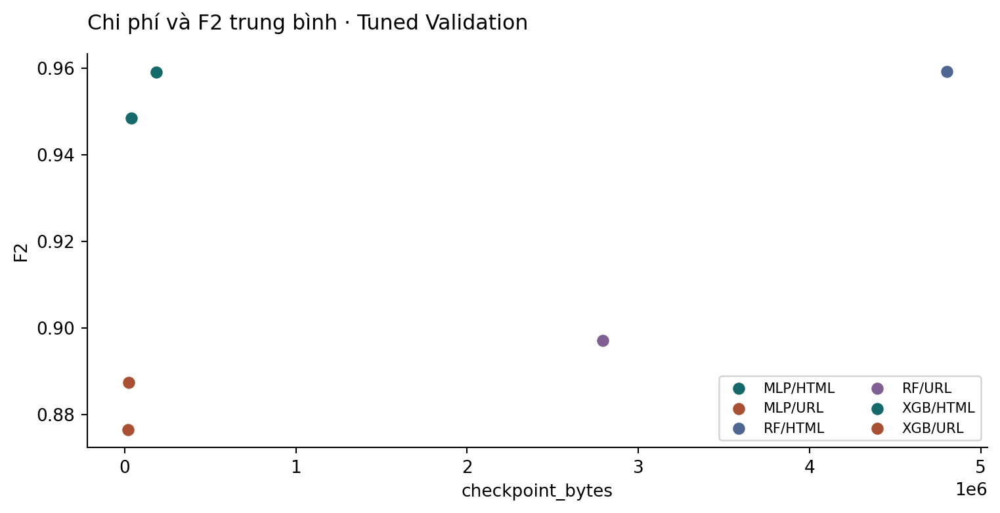

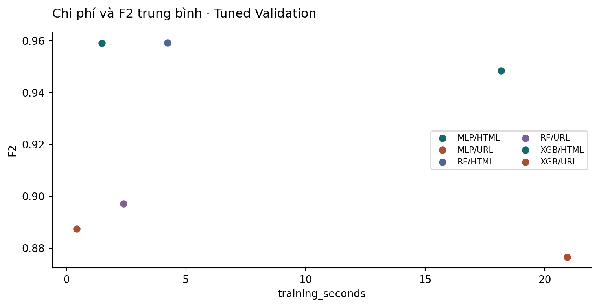

T07 ghi CPU Intel Xeon cho các run cây và Tesla T4, CUDA 12.8, PyTorch 2.8.0+cu128 cho các run MLP dùng cấu hình này. CPU phục vụ cây, MLP train trên CUDA và suy luận bằng NumPy. RAM khả dụng khi probe khác peak RAM của training. Dữ liệu không đủ để kết luận về tốc độ CPU so với GPU trong cùng thuật toán và cấu hình. API demo đọc/kiểm checksum và nạp checkpoint trong đường xử lý, nên latency HTTP bao gồm I/O khác với latency predict_proba trong T25.

Cộng training_seconds của 24 trial theo cặp trong T13 cho RF URL/URL+HTML lần lượt 158,08/222,78 giây, XGBoost 21,43/33,31 giây và MLP 694,51/777,60 giây. Đây là tổng chi phí fit theo nhật ký ba fold của từng trial, không gồm toàn bộ thời gian chờ Drive hoặc thời gian thao tác notebook.

## 27. Kiến trúc hệ thống

Streamlit gửi JSON cho FastAPI qua HTTP loopback. Backend giới hạn kích thước body và thời gian nhận, xác minh input, chọn checkpoint theo sự hiện diện của snapshot hợp lệ, kiểm tra schema và hash trước khi giải tuần tự hóa. Cùng mã extract_features phục vụ offline và online. Registry, thư mục checkpoint và các nguồn cài đặt cần có quyền ghi tin cậy; checksum không thay cho xác thực nguồn phát hành. Các quy tắc local không đủ cho dịch vụ internet đa người dùng.

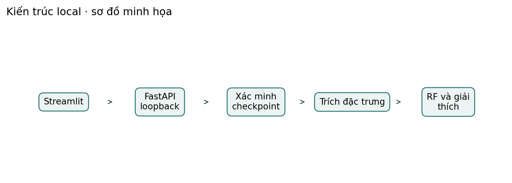

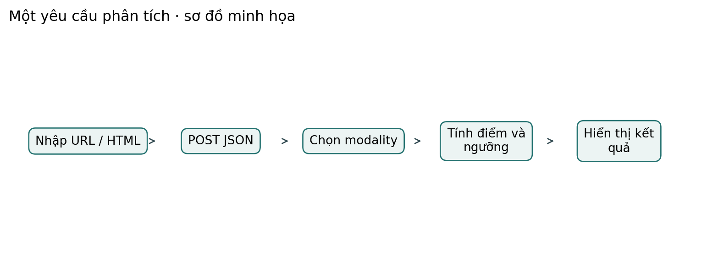

F30 diễn tả một yêu cầu đơn. Backend trả điểm, modality, ngưỡng và đóng góp thực sự tính từ mô hình. HTTP 422 dùng cho input lỗi, 413 cho body hoặc snapshot quá lớn, 503 cho checkpoint/schema chưa sẵn sàng. Live fetch mặc định tắt; không thực thi script hoặc render HTML do người dùng đưa vào. Đối chiếu thực tế gồm request bằng curl và requests, Swagger, thao tác trình duyệt và kết quả offline trên fixture an toàn.

## 28. Thảo luận theo câu hỏi nghiên cứu

**RQ1 và H3.** Hai họ cây dẫn đầu ở Validation URL+HTML. RF tuned nhỉnh hơn XGBoost tuned khoảng 0,020 đpt F2. Chênh lệch này nhỏ so với các nguồn biến thiên chưa đo như thay cohort và campaign. MLP có thể bị bất lợi trên đặc trưng đếm lệch phải hoặc vì inner stopping giảm lượng dữ liệu fit, nhưng thiết kế không tách riêng ảnh hưởng của hai yếu tố.

**RQ2 và H1.** Cả ba so sánh baseline đều có lợi khi thêm HTML. Cơ chế khả dĩ là thông tin cấu trúc trang bổ sung URL, trong khi độ khác biệt giữa nguồn lấy mẫu cũng có thể đóng góp. **RQ3 và H2.** RF và MLP URL+HTML cải thiện F2 Validation; bốn cặp còn lại giảm. Tối ưu trên ba fold Train với một seed, inner stop cho MLP và ngân sách 24 candidate không bảo đảm đúng cấu hình tối ưu trên Validation.

**RQ4 và H4.** Attribution cho biết đặc trưng nào thay đổi điểm của checkpoint trên một mẫu. Bằng chứng định lượng xác nhận tính cộng SHAP; hiệu quả giúp người dùng ra quyết định chưa được đo. **RQ5.** Hai tuyến HTTP và hai màn hình nhập liệu đã được kiểm thử với checkpoint khóa. Local demo chứng minh tích hợp chức năng; triển khai diện rộng vẫn cần kiểm thử tải và bảo vệ dịch vụ.

## 29. Hạn chế và độ giá trị

T26 phân biệt hạn chế dữ liệu, mô hình và vận hành. CompPhish là một corpus, chưa có tập ngoài hoặc temporal split. Domain/HTML hash không loại hết near-duplicate và campaign overlap. Nguồn legitimate thiên về các website phổ biến. Lưu lượng thực có thể khác prevalence, nội dung dựng bởi JavaScript và cách thu snapshot. Với ba seed, một split và một seed tuning, độ bất định do lấy mẫu không được ước lượng đầy đủ. Tỷ lệ FP trên Test 12,029% hạn chế khả năng chặn tự động. Calibration chưa đánh giá; chưa có Test riêng cho fallback.

Internal validity chịu ảnh hưởng của rò rỉ chưa quan sát và cách dừng sớm của MLP. External validity bị giới hạn ở một corpus và một thời kỳ. Construct validity phụ thuộc nhãn nguồn, snapshot tĩnh và mức độ F2 đại diện cho chi phí thực tế. Statistical conclusion validity bị giới hạn bởi một split, ba seed và nhiều candidate cùng so trên một tập OOF.

## 30. Hướng nghiên cứu tiếp theo

Khóa giao thức mới trước khi thu corpus theo thời gian và theo chiến dịch, đánh giá external validation, calibration và mức suy giảm khi thiếu HTML. Để đo riêng lợi ích của width, dropout hay regularization, cần factorial hoặc controlled sweep với ngân sách cân đối. Có thể bổ sung nhóm near-duplicate HTML và so với split hiện tại trên dữ liệu phát triển mới. Thử nghiệm UX nên đo thời gian xử lý và tỷ lệ quyết định đúng khi có/không có giải thích. Các hướng này không sửa checkpoint hoặc kết quả Test đã công bố.

Nếu đưa vào quy trình vận hành, cần đăng ký trước chính sách threshold theo chi phí FP/FN, theo dõi phân bố biến và drift của nhãn, quy định khi nào được retrain và cách kiểm lại trên holdout mới. Một tiện ích trình duyệt chỉ nên được đánh giá trên một môi trường thử nghiệm được phép, với chính sách thu thập dữ liệu và egress được thẩm định.

## 31. Kiểm soát chất lượng

Kiểm 8 raw hashes, feature manifest, split và CV, đúng số ID/nhãn trong OOF và Test, danh tính và hyperparameters, cấu hình phần cứng/phần mềm, tệp checkpoint được lưu, replay Validation, xếp hạng winner, phê duyệt khớp selection, SHAP cộng đúng. Bằng chứng chi tiết có trong FINAL_EXPERIMENT_AUDIT, T27, T28 và experiment_integrity.csv. Với XGBoost, so ROC-AUC/PR-AUC/AP sau replay có dung sai tuyệt đối tối đa $10^{-5}$ để tính đến số học giữa nền tảng; tất cả SHA-256 so chính xác. Timestamp hệ thống tệp hỗ trợ lập trình tự nhưng không phải chữ ký thời gian độc lập.

Bảng kiểm dưới đây ghi tiêu chí theo từng mã. T27 ghi trạng thái cho từng mục sau khi đọc hồ sơ. QC18 dùng mốc thời gian filesystem cùng SHA phê duyệt. QC19 đối chiếu kết quả đã lưu và biến động trong lần bàn giao.

|Mã|Đối tượng|Điều kiện đạt|Bằng chứng|
|---|---|---|---|
| QC01 | Dataset | 8 tệp khớp SHA công bố | dataset_manifest.json |
| QC02 | Cohort | 15.327 ID, digest khớp lock | lock.json |
| QC03 | Schema | 17/34 cột đúng phiên bản và thứ tự | features.json |
| QC04 | Split | Tổng 10.729 / 2.299 / 2.299, khớp hash | assignments.csv |
| QC05 | Giao tập | 0 URL/domain/exact HTML hash thuộc nhiều split | final_audit.py |
| QC06 | CV group | 0 group đi qua hai outer fold | cv_folds.csv |
| QC07 | Preprocessing | Mean, variance, n của scaler bằng phần fit tương ứng | final_audit.py |
| QC08 | Baseline | 18 tổ hợp duy nhất, COMPLETED | baseline_v1.json |
| QC09 | Tuning | 144 trial có OOF và manifest hợp lệ | experiment_integrity.csv |
| QC10 | Fold | 432 phép đánh giá có số dòng và metric khớp | experiment_integrity.csv |
| QC11 | Khóa tuning | 6 winner theo thứ tự F2, Precision, FPR và tie-break | results/tuning_v2/ |
| QC12 | Tuned | 18 refit hợp lệ có tuning lock tương ứng | tuned_v2.json |
| QC13 | Bất biến baseline | Đối chiếu config, metric, manifest và checkpoint V1 | baseline_v1.json |
| QC14 | Checkpoint | SHA khớp bytes trước khi nạp | artifact_checksums.json |
| QC15 | Tái lập metric | Replay Validation, OOF và metric Test từ dự đoán lưu | audit_summary.json |
| QC16 | Ngưỡng | Tính lại xếp hạng ngưỡng OOF và Validation theo luật khóa | final_audit.py |
| QC17 | Selection | Xếp lại sáu cặp V2 và chọn seed khớp SHA checkpoint | model_selection_v2.json |
| QC18 | Phê duyệt | APPROVED trỏ đúng SHA selection, mtime theo trình tự | project_leader_approval.json |
| QC19 | Locked Test | 2.299 ID, nhãn, ngưỡng và toàn bộ metric khớp artifact | locked_test.json |
| QC20 | SHAP | 24 ID × 34 cột, base và tính cộng khớp checkpoint | contributions.csv |
| QC21 | Feature parity | 24 snapshot Validation được trích lại theo hai schema | final_audit.py |
| QC22 | Dự đoán API | So nhãn, điểm, ngưỡng và đóng góp với offline | http_evidence.json |
| QC23 | Fallback | URL-only dùng seed 44, 17 cột và ngưỡng 0,15 | http_evidence.json |
| QC24 | UI ↔ API | Thao tác trình duyệt và POST xuất hiện trong access log | local_server.log |
| QC25 | Đầu vào tĩnh | Kiểm 413, 422, checksum, HTML và lỗi backend | pytest.xml |
| QC26 | Tái lập | Có hướng dẫn, kết quả phân tích và bằng chứng chạy cục bộ | DEPLOYMENT_GUIDE.md |

## 32. Quyết định khóa và tái lập

| Thành phần | Giá trị đã khóa |
|---|---|
| Dữ liệu, schema | CompPhish v4, cohort 15.327, schema 1.0.0 |
| Membership | Split seed 2026, nhóm domain–HTML, 70/15/15 |
| CV và tìm kiếm | 3 fold Train; 24 candidate/cặp; seed 2026; seed fit 42 |
| Train chính thức | Seed 42, 43, 44; cùng split |
| Tiêu chí | Phishing F2, lưới ngưỡng 0,05–0,95 |
| Sản phẩm | Primary RF URL+HTML seed 43; fallback RF URL-only seed 44 |

Split SHA-256 **d3ecbd33e6597b3c75f036c8c58a86f84addf4790743b467666d83d903cdd3e5**. CV membership SHA-256 **fd766213fca49c34bc2c3f6dd8b4edb69d3d28f378cac0f01633ae4fa8ec94cd**.

~~~text
01. Kiểm raw bằng manifest; ghép snapshot và nhãn theo ID.
02. Từ URL và HTML tĩnh, trích đúng 17/34 cột; khóa cohort.
03. Union các hàng chung domain hoặc hash; giữ nhóm khi chia.
04. Train V1 theo cấu hình cố định; chấm điểm trên Validation.
05. Với mỗi candidate, dùng các fold nằm trọn trong Train.
06. Gộp OOF, chọn ngưỡng và candidate; khóa siêu tham số.
07. Fit V2 trên Train; MLP dừng theo Validation của run.
08. Quét ngưỡng Validation của mỗi run; lưu điểm vận hành.
09. Xếp nhóm rồi xếp seed bằng Validation; khóa hai bundle.
10. Kiểm phê duyệt; chấm primary trên Test với ngưỡng khóa.
11. Giải thích primary bằng nền Train và mẫu Validation.
12. HTTP có snapshot → 34 cột; chỉ URL → 17 cột.
13. Kiểm SHA và schema; tính điểm, áp ngưỡng, trả đóng góp.
Mỗi họ và modality: baseline × ba seed trên cùng Train
Mỗi candidate: fit ở outer-train, dự đoán outer-validation
Gộp OOF → chọn ngưỡng và candidate → khóa cấu hình
Fit Tuned × ba seed → chọn ngưỡng từ Validation từng run
Xếp trung bình ba seed → chọn checkpoint → duyệt → chấm Test
Hậu nghiệm: chỉ đọc artifact → tái tính bảng, hình, giải thích
~~~

## 33. Registry và nguồn bằng chứng

Mỗi seed có manifest và checkpoint theo attempt; mỗi trial có config, metric pooled, metric từng fold, dự đoán OOF, tài nguyên và manifest. Dataset/feature/CV lock nằm trong manifests và data/splits; selection nối 6 tuning lock với 18 run manifest V2 và bản checkpoint cài cho API. T28 là danh mục chi tiết có hash, bảng và hình có index riêng. EDA, giải thích, API, HTTP log và screenshot có vai trò riêng trong hồ sơ bàn giao.

|Nhóm tệp|Thao tác tạo|Kiểm tra / sử dụng|
|---|---|---|
|data/raw, processed|Nhập CompPhish, lập cohort|Hash, khóa chia nhóm|
|features, splits|Trích URL/HTML và chia chỉ mục|EDA, CV, dự đoán|
|results/tuning_v2|Gộp 3 fold Train|OOF và khóa candidate|
|checkpoints, runs|Huấn luyện V1/V2 chính thức|Phát lại Validation|
|manifests, selected_model|Khóa lựa chọn, duyệt Test|API và audit|
|results/metrics, explainability|Đánh giá, giải thích mô hình chính|T21–T24, F22–F26|

Ngoài registry hash khoa học, các đầu mối bàn giao hệ thống gồm src/phishshield/api/app.py (FastAPI 2.0, nhận request từ UI), src/phishshield/ui/app.py (Streamlit, người dùng), reports/final/http_evidence.json (verify_local.py, nghiệm thu), reports/final/local_server.log (Uvicorn, đối chiếu HTTP), reports/final/screenshots/ (check_ui.cjs, bằng chứng trình duyệt) và reports/final/PhishShield-AI-Final-Report.pdf (báo cáo Final 1.0, hội đồng).

## 34. Kết luận

Trong phạm vi CompPhish, bổ sung HTML thay đổi F2 Validation lớn hơn nhiều so với thay đổi từ tuning trong cùng modality. Mô hình triển khai ưu tiên giảm bỏ sót và còn cảnh báo nhầm đáng kể. Đóng góp của nhóm là pipeline tái lập, so sánh có kiểm soát, giải thích đối chiếu với checkpoint và hệ thống local có bằng chứng HTTP. Bước đánh giá kế tiếp cần dữ liệu độc lập để đo khả năng chuyển giao.

## 35. Tài liệu tham khảo

1. Richa Goenka (2026). *CompPhish*, version 4, Mendeley Data. [DOI 10.17632/fmbs4kp9wz.4](https://data.mendeley.com/datasets/fmbs4kp9wz/4).
2. Leo Breiman (2001). *Random Forests*, Machine Learning 45, 5–32. [DOI 10.1023/A:1010933404324](https://www.stat.berkeley.edu/users/breiman/randomforest2001.pdf).
3. Tianqi Chen và Carlos Guestrin (2016). *XGBoost: A Scalable Tree Boosting System*, KDD. [DOI 10.1145/2939672.2939785](https://arxiv.org/abs/1603.02754).
4. Scott M. Lundberg và Su-In Lee (2017). *A Unified Approach to Interpreting Model Predictions*, NeurIPS. [Bản tác giả, DOI 10.48550/arXiv.1705.07874](https://arxiv.org/abs/1705.07874).
5. Fabian Pedregosa và cộng sự (2011). *Scikit-learn: Machine Learning in Python*, JMLR 12, 2825–2830. [Bài báo chính thức](https://jmlr.org/papers/v12/pedregosa11a.html).
6. Adam Paszke và cộng sự (2019). *PyTorch: An Imperative Style, High-Performance Deep Learning Library*, NeurIPS. [DOI 10.48550/arXiv.1912.01703](https://arxiv.org/abs/1912.01703).
7. Takaya Saito và Marc Rehmsmeier (2015). *The Precision-Recall Plot Is More Informative than the ROC Plot When Evaluating Binary Classifiers on Imbalanced Datasets*, PLOS ONE 10(3). [DOI 10.1371/journal.pone.0118432](https://journals.plos.org/plosone/article?id=10.1371/journal.pone.0118432).
8. Justin Ma, Lawrence K. Saul, Stefan Savage và Geoffrey M. Voelker (2009). *Beyond Blacklists: Learning to Detect Malicious Web Sites from Suspicious URLs*, KDD. [Bản tác giả](https://cseweb.ucsd.edu/~jtma/papers/beyondbl-kdd2009.pdf).

## Phụ lục tra cứu bảng số liệu

|Bảng|Dữ liệu máy đọc|
|---|---|
|T01|[dataset](../../reports/final/tables/T01_dataset.csv)|
|T02|[data_audit](../../reports/final/tables/T02_data_audit.csv)|
|T03|[classes](../../reports/final/tables/T03_classes.csv)|
|T04|[dictionary](../../reports/final/tables/T04_dictionary.csv)|
|T05|[splits](../../reports/final/tables/T05_splits.csv)|
|T06|[folds](../../reports/final/tables/T06_folds.csv)|
|T07|[hardware](../../reports/final/tables/T07_hardware.csv)|
|T08|[baseline](../../reports/final/tables/T08_baseline.csv)|
|T09|[spaces](../../reports/final/tables/T09_spaces.csv)|
|T10|[matrix](../../reports/final/tables/T10_matrix.csv)|
|T11|[baseline_seeds](../../reports/final/tables/T11_baseline_seeds.csv)|
|T12|[baseline_summary](../../reports/final/tables/T12_baseline_summary.csv)|
|T13|[trials](../../reports/final/tables/T13_trials.csv)|
|T14|[parameters](../../reports/final/tables/T14_parameters.csv)|
|T15|[tuned_seeds](../../reports/final/tables/T15_tuned_seeds.csv)|
|T16|[tuned_summary](../../reports/final/tables/T16_tuned_summary.csv)|
|T17|[paired_seeds](../../reports/final/tables/T17_paired_seeds.csv)|
|T18|[ablation](../../reports/final/tables/T18_ablation.csv)|
|T19|[paired_statistics](../../reports/final/tables/T19_paired_statistics.csv)|
|T20|[selection](../../reports/final/tables/T20_selection.csv)|
|T21|[test_metrics](../../reports/final/tables/T21_test_metrics.csv)|
|T22|[confusion](../../reports/final/tables/T22_confusion.csv)|
|T23|[shap](../../reports/final/tables/T23_shap.csv)|
|T24|[error_cases](../../reports/final/tables/T24_error_cases.csv)|
|T25|[cost](../../reports/final/tables/T25_cost.csv)|
|T26|[limitations](../../reports/final/tables/T26_limitations.csv)|
|T27|[qc](../../reports/final/tables/T27_qc.csv)|
|T28|[registry](../../reports/final/tables/T28_registry.csv)|
