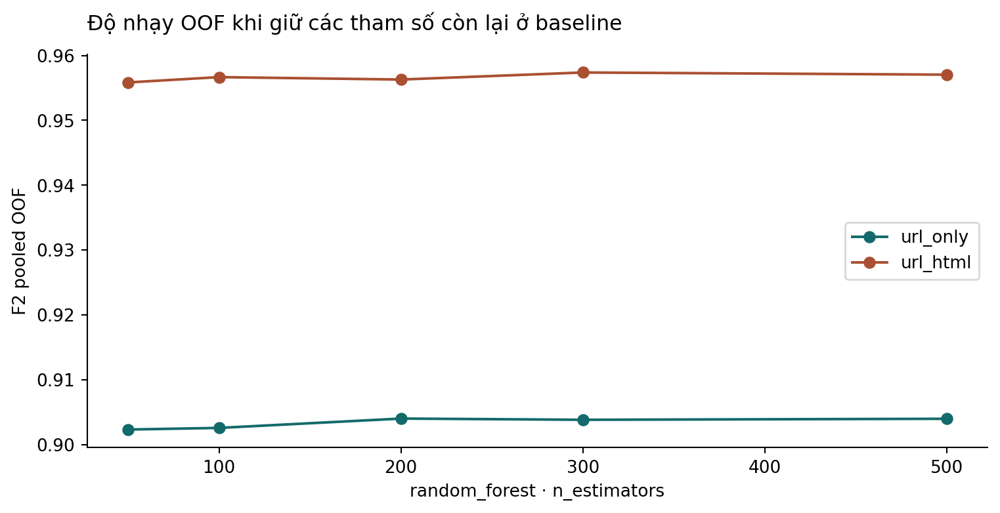
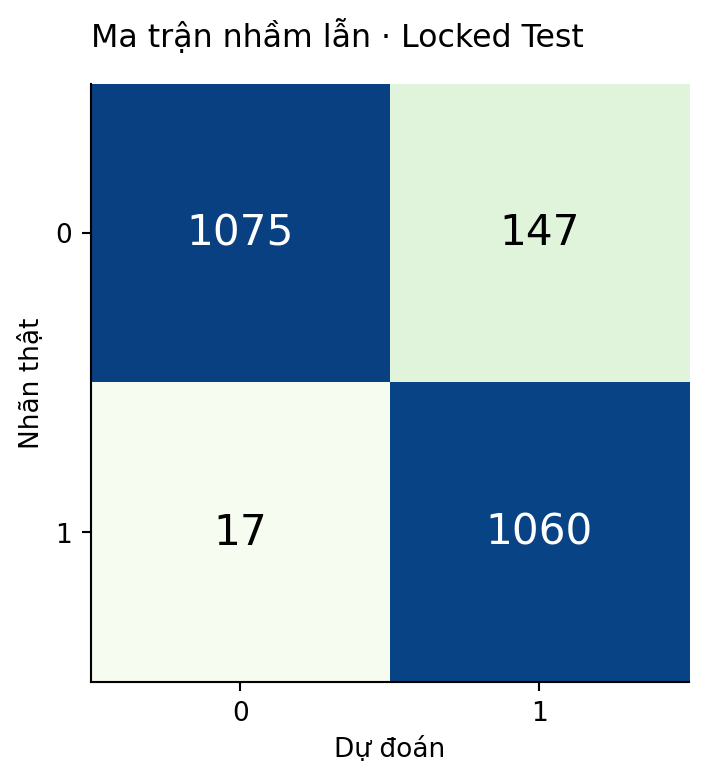
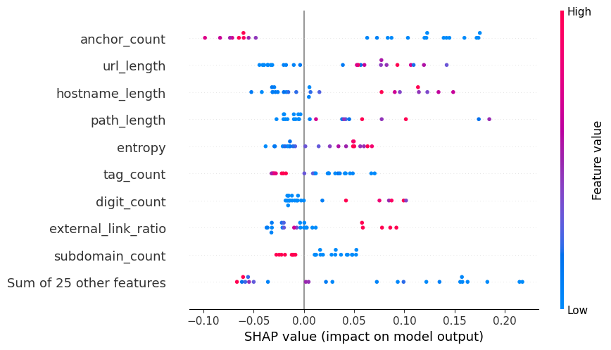
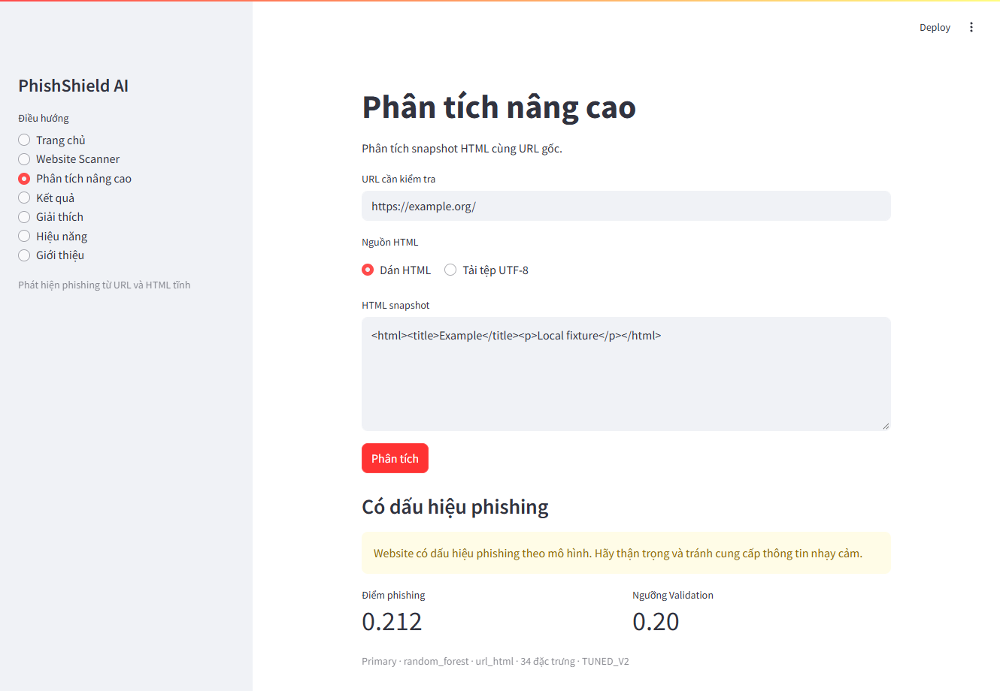

# PhishShield AI

*Bản công khai Gate 7. Các bảng theo mẫu được tổng hợp để bảo vệ dữ liệu nghiên cứu.*

**Phát hiện website lừa đảo từ URL và HTML tĩnh bằng học máy có giải thích**

Báo cáo đồ án • 28/11/2026

Gịp Xương Thanh Quyền — Random Forest  
Vũ Thị Tuyết Trang — XGBoost  
Võ Hữu Nghĩa — MLP, trưởng nhóm

## 1. Tóm tắt

Một công cụ kiểm tra đường dẫn thường chỉ nhận được URL trước khi người dùng mở trang. Khi có bản chụp HTML, công cụ có thêm bằng chứng về biểu mẫu, liên kết và cấu trúc trang. Nhóm đo giá trị của nguồn thông tin thứ hai trên CompPhish v4 bằng ba họ mô hình, với cùng tập website và cùng cách chia nhóm. Trong cấu hình baseline, HTML nâng F2 trung bình trên Validation từ 6,005 đến 6,599 điểm phần trăm. Thay đổi sau tinh chỉnh nhỏ hơn và phụ thuộc mô hình. Với điểm vận hành đã khóa, Random Forest dùng URL và HTML tìm đúng 1.060 trong 1.077 mẫu phishing trên Test, đồng thời đưa ra 147 cảnh báo nhầm. Bản demo chạy cục bộ tái sử dụng hai checkpoint chính thức. Kết quả mô tả bộ dữ liệu và những điều kiện đánh giá này.

## 2. Giới thiệu

Một tên miền có HTTPS hoặc một trang có ô nhập mật khẩu đều có thể phục vụ mục đích hợp lệ. Bộ phân loại phải kết hợp nhiều tín hiệu yếu trước khi phát cảnh báo. Bài toán của nhóm là ước lượng điểm phishing từ một ảnh chụp tại thời điểm thu thập, đưa ra nhãn nhị phân theo ngưỡng và cho người dùng biết mô hình đã dựa vào những đặc trưng nào.

Ba câu hỏi định hướng phần thực nghiệm. Thêm HTML mang lại bao nhiêu cải thiện khi giữ nguyên tập đánh giá? Tinh chỉnh cấu hình có làm thay đổi điểm vận hành ngoài tập tìm kiếm? Khi ưu tiên phát hiện phishing, người dùng phải chấp nhận bao nhiêu cảnh báo nhầm? Để trả lời, nhóm tách riêng quá trình chọn siêu tham số trên Train, chọn ngưỡng trên Validation và đánh giá cuối trên Test.

## 3. Công trình liên quan

Ma và cộng sự nghiên cứu việc nhận biết URL nguy hiểm từ các đặc tính quan sát được của địa chỉ. Random Forest của Breiman gộp dự đoán của nhiều cây, còn XGBoost của Chen và Guestrin liên tiếp bổ sung cây để giảm hàm mất mát. Hai cách xây dựng cây tạo phép đối chứng với MLP học quan hệ phi tuyến trên cùng biểu diễn dạng bảng. Nghiên cứu này dùng dữ liệu và quy tắc chia riêng, vì vậy các điểm số bên dưới có ý nghĩa so sánh trong nội bộ thí nghiệm.

Lundberg và Lee đặt nền tảng cho cách phân bổ một dự đoán thành đóng góp của từng đặc trưng so với một mức tham chiếu. Nhóm sử dụng nguyên lý cộng tính để kiểm tra phần giải thích. Khi hai biến cùng mô tả kích thước trang, thứ hạng đóng góp còn phụ thuộc phân bố tham chiếu và cách xử lý quan hệ giữa chúng.

## 4. Dữ liệu và chuẩn bị dữ liệu

CompPhish v4 cung cấp định danh mẫu, URL, thông tin nhãn và snapshot HTML tương ứng. Kho đầu vào có 15.358 mẫu. Sau kiểm tra cú pháp URL và nội dung HTML, cohort dùng chung có 15.327 mẫu. Có 23 URL không hợp lệ và tám snapshot rỗng. Kiểm toán còn ghi nhận bảy dòng URL trùng và 2.178 dòng snapshot trùng theo quy ước của bảng audit. Giữ dấu vết của chúng trong dữ liệu nguồn cho phép kiểm tra lại cách tạo nhóm.

| Tập | Hợp lệ | Phishing | Tổng | Vai trò |
|---|---:|---:|---:|---|
| Train | 5.703 | 5.026 | 10.729 | Học và tìm candidate |
| Validation | 1.222 | 1.077 | 2.299 | Chọn ngưỡng, so các run |
| Test | 1.222 | 1.077 | 2.299 | Đánh giá primary đã khóa |

Các mẫu có liên hệ theo khóa nhóm được đặt vào cùng một tập. So với việc rút ngẫu nhiên từng dòng, cách chia này giảm nguy cơ nhận lại một tên miền hoặc snapshot từ Train khi đánh giá. Kiểm tra trực tiếp các partition bổ sung cho việc kiểm tra SHA-256 của chỉ mục chia.

## 5. Kỹ thuật đặc trưng

Bộ triển khai tính 17 biến từ URL và bổ sung 17 biến khi có HTML. Nhóm URL mô tả tên máy, độ dài, đường dẫn, ký tự và mã hóa. Nhóm HTML mô tả số thẻ, biểu mẫu, trường nhạy cảm, liên kết, tài nguyên ngoài và tiêu đề. Chẳng hạn, số thẻ neo phản ánh cấu trúc điều hướng nhưng một trang hợp lệ tối giản cũng có thể có ít liên kết. Một tên máy dài có thể xuất hiện trên hạ tầng dịch vụ hợp lệ.

Dùng cùng hàm trích xuất khi nghiên cứu và khi phục vụ giúp mỗi cột có nghĩa nhất quán. Bảng 70 biến tính sẵn của nguồn dữ liệu phục vụ đối chiếu. Bộ 34 biến triển khai được tính trực tiếp trên đầu vào runtime. Khi thiếu HTML, checkpoint URL-only xử lý đúng 17 cột mà nó đã học. [Từ điển và quy tắc tính](tables/T04_dictionary.csv).

## 6. Phương pháp

Random Forest trung bình hóa xác suất của các cây. Độ sâu, số mẫu tối thiểu ở lá và số biến xét tại mỗi lần tách điều khiển mức độ chi tiết của ranh giới. XGBoost tối ưu tuần tự, nên ảnh hưởng của số vòng boosting gắn với tốc độ học và regularization. MLP chuẩn hóa đầu vào theo dữ liệu học và tối ưu mạng truyền thẳng. Dùng ba họ mô hình cho phép so sánh một cơ chế trung bình hóa, một cơ chế boosting và một mô hình học biểu diễn trên dữ liệu dạng bảng.

Nhãn dương là phishing. Quy tắc dự đoán dương là $s(x)\ge t$. Nhóm ưu tiên $F_2=5PR/(4P+R)$, trong đó $P$ là Precision và $R$ là Recall. Với $\beta=2$, mẫu số ở dạng đếm chứa $4FN$ và $FP$. F2 biểu diễn ưu tiên giảm bỏ sót trong thí nghiệm. Chi phí thực tế của một cảnh báo nhầm vẫn phụ thuộc bối cảnh ứng dụng.

## 7. Thiết kế thực nghiệm

Mỗi pha đánh giá ba mô hình, hai modality và ba seed 42, 43, 44. Vì V1 và V2 dùng chung một split, hiệu giữa hai pha có thể tính theo từng cặp có cùng seed. Ba seed chỉ đo một phần biến thiên thuật toán trên cùng dữ liệu. Số liệu trình bày theo trung bình, độ lệch chuẩn mẫu và biên quan sát. Thiết kế không cung cấp ba quần thể website độc lập cho kiểm định ý nghĩa thống kê.

Phần tuning chia riêng 10.729 mẫu Train thành ba fold có 3.034, 3.834 và 3.861 dòng. Sự chênh lệch kích thước phản ánh ràng buộc giữ nhóm nguyên vẹn. Mỗi mẫu Train nhận một dự đoán ngoài fold cho mỗi candidate. Đánh giá OOF gộp trọng số theo số mẫu. Validation xác lập điểm vận hành cho checkpoint refit. Manifest lựa chọn và phê duyệt của trưởng nhóm có trước kết quả Test theo hồ sơ lưu.

## 8. Tối ưu siêu tham số

Có 24 candidate cho mỗi cặp mô hình và modality, tổng cộng 144 candidate và 432 lượt đánh giá fold. Các sweep có kiểm soát giúp quan sát ảnh hưởng của tham số khi những tham số còn lại được giữ cố định. Một candidate phối hợp nhiều thay đổi chỉ cho phép kết luận về tổ hợp. Hình dưới biểu diễn dữ liệu CV đã ghi nhận.

RF chọn 300 cây cho cả hai modality, với C022 cho URL và C019 cho URL+HTML. XGBoost chọn 100 vòng cho URL (C006) và 300 vòng cho URL+HTML (C004). Ở MLP, cả hai nhánh chọn C021 với lớp ẩn 256 nút, so với 64 nút ở baseline. Các giá trị trên là lựa chọn tốt nhất theo quy tắc trong ngân sách đã chạy. Thu thập thêm candidate hoặc thay phân bố website có thể làm thay đổi thứ hạng.

## 9. Kết quả thực nghiệm

| Mô hình | URL V1 | URL V2 | URL+HTML V1 | URL+HTML V2 |
|---|---:|---:|---:|---:|
| Random Forest | 89,805 | 89,707 | 95,810 | 95,920 |
| XGBoost | 89,760 | 88,736 | 96,048 | 95,900 |
| MLP | 87,775 | 87,657 | 94,374 | 94,850 |

Các ô là F2 trung bình (%) trên Validation, ba seed. Ở baseline, chênh lệch ghép cặp khi thêm HTML lần lượt đạt +6,005, +6,289 và +6,599 điểm phần trăm. Ở pha tuned, mỗi nhánh có thể chọn cấu hình khác nên chênh lệch đồng thời chứa ảnh hưởng của cấu hình. Với XGBoost URL-only, F2 giảm 1,023 điểm và FPR tăng 10,229 điểm sau tuning. Việc chọn trên OOF Train và việc đo trên Validation sử dụng những nhóm website khác nhau, khiến mức cải thiện không được bảo đảm.

Primary đã khóa là RF URL+HTML, seed 43, ngưỡng 0,20. Trên 2.299 mẫu Test, có 1.075 âm tính đúng, 147 dương tính giả, 17 âm tính giả và 1.060 dương tính đúng. Accuracy đạt 92,87%, Precision 87,82%, Recall 98,42%, F1 92,82%, F2 96,10% và FPR 12,03%. ROC-AUC đạt 0,98979 và diện tích PR theo hình thang đạt 0,98948. AUC mô tả chất lượng xếp hạng qua nhiều ngưỡng. Ma trận dưới mô tả quyết định tại đúng ngưỡng đã triển khai.

## 10. Khả năng giải thích

Hồ sơ SHAP dùng 32 mẫu Train làm nền và 24 mẫu Validation để giải thích primary. Đối với từng dòng, cộng điểm nền với đóng góp của 34 biến tái tạo xác suất của checkpoint. Sai số tuyệt đối lớn nhất khi kiểm lại khoảng $1,78\times10^{-15}$. Ba biến đứng đầu theo trung bình trị tuyệt đối gồm số thẻ neo (0,10395), độ dài URL (0,05756) và độ dài tên máy (0,05257).

Phân tích cục bộ đối chiếu tổng đóng góp với điểm dự đoán trên Validation. Bản nội bộ của nhóm lưu các ví dụ theo ID. Bảng công khai tổng hợp đóng góp theo đặc trưng.

## 11. Triển khai hệ thống

Streamlit gửi URL và snapshot tùy chọn tới FastAPI qua HTTP trên loopback. Backend chọn một trong hai bundle theo dữ liệu đầu vào, kiểm SHA-256 và thứ tự cột trước khi suy luận. Có HTML thì chạy checkpoint 34 biến tại ngưỡng 0,20. Chỉ có URL thì chạy checkpoint 17 biến tại ngưỡng 0,15. Phản hồi kèm điểm, ngưỡng, modality, phiên bản checkpoint và các yếu tố đóng góp. Snapshot được phân tích tĩnh và chức năng tải trang bị tắt trong bản demo.

Nhóm dùng trình duyệt thật nhập URL mẫu, chạy cả hai nhánh và mở màn hình giải thích cùng bảng hiệu năng. Điểm, ngưỡng, định danh model và các đóng góp của REST API được đối chiếu với lời gọi Python trực tiếp. Hình dưới lấy từ phiên demo cục bộ.

## 12. Thảo luận

Ở baseline, thêm HTML tăng F2 trên cả ba họ mô hình. Tín hiệu này nhất quán hơn hiệu ứng tuning. Việc MLP được lợi nhiều nhất về F2 khi thêm HTML cũng không làm nó đạt điểm tuyệt đối cao nhất. Một cấu hình có thể tăng Recall và đồng thời làm giảm Precision khi điểm vận hành chuyển về phía nhạy hơn.

Có 147 cảnh báo nhầm và 17 trường hợp bỏ sót trên Test. Phân tích nội bộ ghi nhận cả lỗi sát ngưỡng và lỗi ở xa ngưỡng. Bảng công khai trình bày kết quả tổng hợp theo loại dự đoán.

## 13. Hạn chế

Cohort bắt buộc có HTML để hai modality được đối chiếu trên cùng website. Nhánh URL-only do đó chưa được đánh giá riêng trên các trang thực tế không lấy được snapshot. Nhóm trùng lặp xử lý quan hệ đã định nghĩa, còn họ trang hay chiến dịch khác tên miền có thể vượt qua quy tắc nhóm. Nhãn, thời điểm thu thập và tỷ lệ phishing của nguồn ảnh hưởng đến khả năng chuyển giao. Điểm đầu ra chưa được hiệu chỉnh xác suất. FPR 12,03% cần được cân nhắc trước khi dùng cảnh báo để chặn truy cập.

## 14. Hướng phát triển

Bước thực nghiệm tiếp theo có thể khóa trước một cohort theo thời gian, công bố số FN trên từng nhóm trang, và kiểm tra hiệu chỉnh xác suất bằng dữ liệu dành riêng cho calibration. Một nghiên cứu vận hành cần đo độ trễ đồng thời, phân bố đầu vào thiếu snapshot và tỷ lệ cảnh báo được người dùng xác nhận. Các phép đo đó cần dữ liệu và biên bản đánh giá mới.

## 15. Kết luận

Trên cohort đã khóa, cấu trúc HTML bổ sung bằng chứng cho cả ba họ mô hình. Bản triển khai giữ nguyên hai điểm vận hành được lựa chọn trước Test và có thể truy ngược từ một phản hồi đến checkpoint đã dùng. Với 17 lần bỏ sót và 147 lần cảnh báo nhầm trên Test, hệ thống thích hợp để minh họa sự đánh đổi khi ưu tiên Recall trong một đồ án phát hiện phishing.

## 16. Tài liệu tham khảo

1. Richa Goenka (2026). *CompPhish*, version 4, Mendeley Data. [DOI 10.17632/fmbs4kp9wz.4](https://data.mendeley.com/datasets/fmbs4kp9wz/4).
2. Leo Breiman (2001). *Random Forests*, Machine Learning 45, 5–32. [DOI 10.1023/A:1010933404324](https://www.stat.berkeley.edu/users/breiman/randomforest2001.pdf).
3. Tianqi Chen và Carlos Guestrin (2016). *XGBoost: A Scalable Tree Boosting System*, KDD. [DOI 10.1145/2939672.2939785](https://arxiv.org/abs/1603.02754).
4. Scott M. Lundberg và Su-In Lee (2017). *A Unified Approach to Interpreting Model Predictions*, NeurIPS. [Bản tác giả, DOI 10.48550/arXiv.1705.07874](https://arxiv.org/abs/1705.07874).
5. Fabian Pedregosa và cộng sự (2011). *Scikit-learn: Machine Learning in Python*, JMLR 12, 2825–2830. [Bài báo chính thức](https://jmlr.org/papers/v12/pedregosa11a.html).
6. Adam Paszke và cộng sự (2019). *PyTorch: An Imperative Style, High-Performance Deep Learning Library*, NeurIPS. [DOI 10.48550/arXiv.1912.01703](https://arxiv.org/abs/1912.01703).
7. Takaya Saito và Marc Rehmsmeier (2015). *The Precision-Recall Plot Is More Informative than the ROC Plot When Evaluating Binary Classifiers on Imbalanced Datasets*, PLOS ONE 10(3). [DOI 10.1371/journal.pone.0118432](https://journals.plos.org/plosone/article?id=10.1371/journal.pone.0118432).
8. Justin Ma, Lawrence K. Saul, Stefan Savage và Geoffrey M. Voelker (2009). *Beyond Blacklists: Learning to Detect Malicious Web Sites from Suspicious URLs*, KDD. [Bản tác giả](https://cseweb.ucsd.edu/~jtma/papers/beyondbl-kdd2009.pdf).

## 17. Phụ lục tra cứu

| Nội dung cần đối chiếu | Nguồn trong hồ sơ bàn giao |
|---|---|
| So sánh từng lần chạy cùng seed | [Hiệu ghép cặp](tables/T17_paired_seeds.csv) |
| Toàn bộ cấu hình và điểm ngoài fold | [Bảng candidate](tables/T13_trials.csv) |
| Checkpoint, SHA và ngưỡng | [Registry lựa chọn](tables/T20_selection.csv) |
| Ma trận và toàn bộ chỉ số Test | [Metric gốc](tables/T21_test_metrics.csv) |
| Các trường hợp dự đoán sai | [Bảng tổng hợp lỗi](tables/T24_error_cases.csv) |
| Kiểm tra API trên đường HTTP thật | [Request và response](../product/http_evidence.json) |
| Phương pháp, công thức và giới hạn chi tiết | [Master Protocol](../../docs/final/PHISHSHIELD_AI_EXPERIMENT_PROTOCOL_AND_ANALYSIS.md) |
